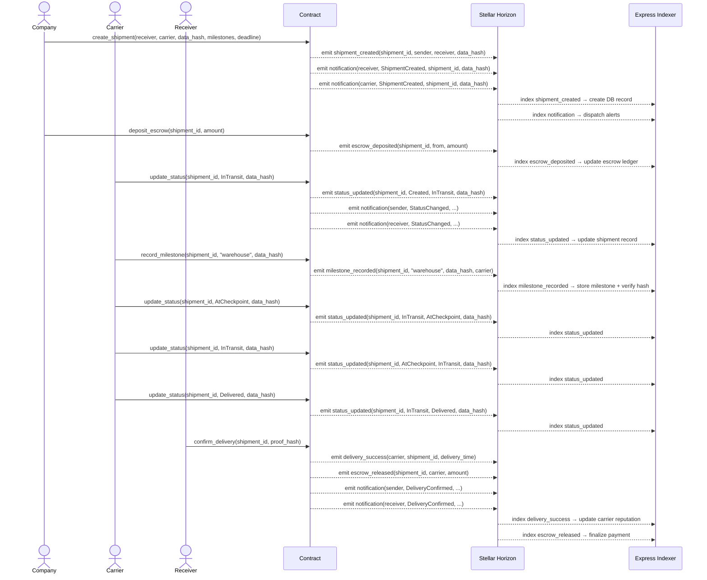
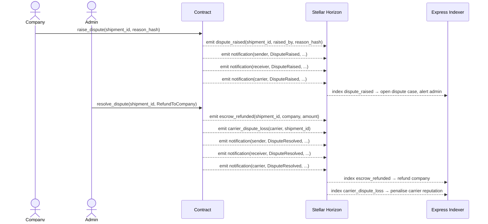
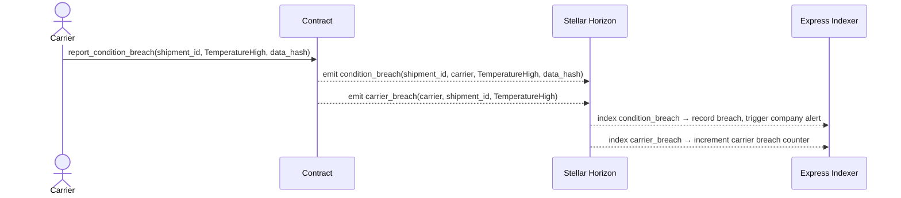
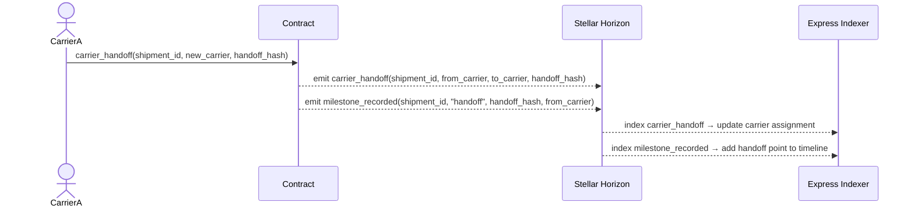
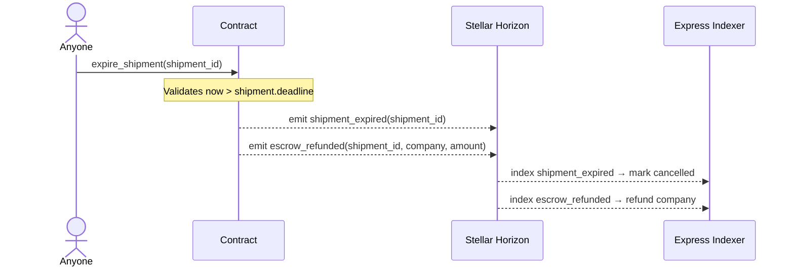

# Shipment Contract — Event Schema Reference

> **Architecture note:** Navin uses a **Hash-and-Emit** pattern. Heavy payloads (GPS traces,
> sensor readings, dispute evidence, milestone metadata) are stored **off-chain**. The contract
> emits only the `shipment_id`, relevant identifiers, and a `BytesN<32>` SHA-256 hash of the
> full payload. The backend indexer verifies integrity by re-hashing the stored payload and
> comparing it against the emitted hash.

---

## Table of Contents

### Shipment Contract

1. [Event Format](#event-format)
2. [Soroban Type Reference](#soroban-type-reference)
3. [Events Index](#events-index)
4. [Shipment Lifecycle Events](#shipment-lifecycle-events)
   - [shipment_created](#shipment_created)
   - [status_updated](#status_updated)
   - [milestone_recorded](#milestone_recorded)
   - [delivery_success](#delivery_success)
   - [shipment_cancelled](#shipment_cancelled)
   - [shipment_expired](#shipment_expired)
5. [Escrow Events](#escrow-events)
   - [escrow_deposited](#escrow_deposited)
   - [escrow_released](#escrow_released)
   - [escrow_refunded](#escrow_refunded)
6. [Carrier Events](#carrier-events)
   - [carrier_handoff](#carrier_handoff)
   - [condition_breach](#condition_breach)
   - [carrier_breach](#carrier_breach)
   - [carrier_dispute_loss](#carrier_dispute_loss)
7. [Dispute Events](#dispute-events)
   - [dispute_raised](#dispute_raised)
8. [Admin Events](#admin-events)
   - [admin_proposed](#admin_proposed)
   - [admin_transferred](#admin_transferred)
   - [contract_upgraded](#contract_upgraded)
   - [init](#init)
   - [set_limit](#set_limit)
   - [set_cmp_limit](#set_cmp_limit)
9. [Notification Events](#notification-events)
   - [notification](#notification)
10. [Lifecycle Sequence Diagram](#lifecycle-sequence-diagram)
11. [TypeScript Type Definitions](#typescript-type-definitions)

### Token Contract

12. [Token Transfer Events](#token-transfer-events)
    - [init](#init-1)
    - [transfer](#transfer)
    - [tr_from](#tr_from)
    - [approve](#approve)
    - [inc_alw](#inc_alw)
    - [dec_alw](#dec_alw)
13. [Token Supply Events](#token-supply-events)
    - [mint](#mint)
    - [burn](#burn)
    - [adm_burn](#adm_burn)
14. [Token Batch Events](#token-batch-events)
    - [batch_leg](#batch_leg)
    - [batch_tr](#batch_tr)

### NFT Contract — Event Schema Reference

15. [NFT Contract Events](#nft-contract-events)
    - [init (NFT)](#init-nft)
    - [mint (NFT)](#mint-nft)
    - [burn (NFT)](#burn-nft)
    - [mintbatch](#mintbatch)
    - [burnbatch](#burnbatch)
    - [xfer (NFT)](#xfer-nft)
    - [approve (NFT)](#approve-nft)
    - [revoked (NFT)](#revoked-nft)
    - [admp](#admp)
    - [admin (NFT)](#admin-nft)
    - [burn_from](#burn_from)
14. [Token Admin Events](#token-admin-events)
    - [admin_pro](#admin_pro)
    - [admin_tr](#admin_tr)
    - [paused](#paused)
    - [unpaused](#unpaused)
15. [Token Metadata Events](#token-metadata-events)
    - [meta_add](#meta_add)
    - [meta_rm](#meta_rm)
    - [meta_set](#meta_set)
    - [meta_del](#meta_del)
16. [Token Batch Events](#token-batch-events)
    - [batch_leg](#batch_leg)
    - [batch_tr](#batch_tr)

---

## Event Format

All events are published via the Soroban SDK's `env.events().publish()` method:

- **Shipment Contract:** `topic: (Symbol,)` — single descriptive symbol for stream filtering.
- **Token Contract:** `topic: (Symbol::new(name), Symbol::new(EVENT_SCHEMA_VERSION_STR))` — 2-element topic tuple carrying the event name symbol and schema version string (e.g., `"v1"`), as defined in [`contracts/token/src/event_topics.rs`](../contracts/token/src/event_topics.rs). Movement events additionally emit a SEP-41-shaped event with address topics (see below).

```
data:   (field1, field2, ...)    — tuple of typed payload fields
```

### SEP-41 token events (#1292)

Token balance movements now also publish standard SEP-41 events alongside the
legacy versioned (`v1`) events. The legacy event is published last for each
operation; indexers must decode **one** shape, not sum both.

| Event | Topics | Data |
| --- | --- | --- |
| `transfer` | `["transfer", from, to]` | `amount: i128` |
| `approve` | `["approve", from, spender]` | `(amount: i128, expiration_ledger: u32)` |
| `mint` | `["mint", to]` | `amount: i128` |
| `burn` | `["burn", from]` | `amount: i128` |

`transfer_from` and `batch_transfer` legs emit `transfer`; `burn_from` and
`admin_burn` emit `burn`; `increase_allowance`/`decrease_allowance` emit
`approve` with the resulting allowance. Initialization emits `mint` for the
initial supply, so a SEP-41 indexer can reconstruct balances from these events
alone.

When subscribing to Horizon's event stream, filter by `contract_id` and the `topic[0]` symbol
to receive only the relevant event type.

### Schema Version and Idempotency

Most shipment contract events — including every shipment lifecycle and escrow
event documented below — carry **no** schema metadata. Their payload ends with
the last field listed in their table.

Only the following RBAC / admin events append three trailing metadata fields
after their own payload:

| Topic            | Emitter                               | Own payload fields                                                                 |
| ---------------- | ------------------------------------- | ---------------------------------------------------------------------------------- |
| `add_wl`         | `emit_whitelist_added`                | `company: Address`, `carrier: Address`                                             |
| `rm_wl`          | `emit_whitelist_removed`              | `company: Address`, `carrier: Address`                                             |
| `ms_init`        | `emit_multisig_initialized`           | `admin_count: u32`, `threshold: u32`                                               |
| `approve`        | `emit_proposal_approved`              | `proposal_id: u64`, `approver: Address`, `approval_count: u32`                     |
| `executed`       | `emit_proposal_executed`              | `proposal_id: u64`, `action: AdminAction`                                          |
| `config_updated` | `emit_circuit_breaker_config_updated` | `"circuit_breaker": Symbol`, `failure_threshold: u32`, `recovery_timeout: u64`, `half_open_max_requests: u32` |

The trailing fields are, in order:

1. `schema_version: u32` — current value is `2` (`EVENT_SCHEMA_VERSION`)
2. `event_counter: u64` — a **contract-wide** counter (`GlobalEventCount`) shared
   by all of the events above. It increases by one for every such event, is not
   scoped to any shipment, and never saturates: the contract fails with
   `CounterOverflow` rather than reuse a value.
3. `idempotency_key: BytesN<32>` — SHA-256 over the canonical preimage
   `domain_len (u32 BE) || domain || event_counter (u64 BE, in the shipment_id slot) || topic_len (u32 BE) || topic || low 32 bits of event_counter (u32 BE)`,
   where `domain` is `0x07` (RBAC) for `add_wl` / `rm_wl` and `0x06` (admin)
   for the others. Because the counter is unique, two emitted events never
   share a key.

> **Note:** the `config_updated` topic is also used by `emit_config_updated`
> (`(admin, new_config)`), which carries no trailing metadata. Distinguish the
> two by payload length or by the leading `"circuit_breaker"` symbol.

This enables safe parser upgrades and indexer deduplication during contract evolution.

### Migration Guidance (v1 -> v2)

1. Keep legacy decoders for historical events without `schema_version`.
2. For the events listed above, branch parser logic by `schema_version`.
3. Use `idempotency_key` as the primary dedup key for those events. Events
   without one can be deduplicated by `(ledger, transaction hash, event index)`.
4. Older deployments emitted `event_counter` as a `u32`; accept either width when decoding.
5. During rollout, allow mixed payloads in the same stream window (older blocks vs new blocks).

---

## Soroban Type Reference

| Soroban Type       | Horizon JSON representation       | Notes                                           |
| ------------------ | --------------------------------- | ----------------------------------------------- |
| `u64`              | `{"u64": "1234"}`                 | Shipment IDs, timestamps, amounts               |
| `i128`             | `{"i128": {"hi": 0, "lo": 1000}}` | Escrow amounts in stroops (1 XLM = 10⁷ stroops) |
| `Address`          | `{"address": "G…"}`               | Stellar account or contract address             |
| `BytesN<32>`       | `{"bytes": "hex…"}`               | 32-byte SHA-256 hash (64 hex chars)             |
| `Symbol`           | `{"symbol": "…"}`                 | Short string identifier (max 32 chars)          |
| `ShipmentStatus`   | `{"enum": N}`                     | Enum variant index (see table below)            |
| `BreachType`       | `{"enum": N}`                     | Enum variant index (see table below)            |
| `NotificationType` | `{"enum": N}`                     | Enum variant index (see table below)            |

### ShipmentStatus Variants

| Variant index | Name           | Description                            |
| ------------- | -------------- | -------------------------------------- |
| 0             | `Created`      | Shipment registered, not yet picked up |
| 1             | `InTransit`    | En route between checkpoints           |
| 2             | `AtCheckpoint` | At an intermediate checkpoint          |
| 3             | `Delivered`    | Delivered to receiver                  |
| 4             | `Disputed`     | Under active dispute                   |
| 5             | `Cancelled`    | Cancelled (terminal)                   |

### BreachType Variants

| Variant index | Name              | Description                           |
| ------------- | ----------------- | ------------------------------------- |
| 0             | `TemperatureHigh` | Temperature exceeded upper limit      |
| 1             | `TemperatureLow`  | Temperature dropped below lower limit |
| 2             | `HumidityHigh`    | Humidity exceeded upper limit         |
| 3             | `Impact`          | Physical shock or drop detected       |
| 4             | `TamperDetected`  | Tamper detection triggered            |

### NotificationType Variants

| Variant index | Name                  | Description                        |
| ------------- | --------------------- | ---------------------------------- |
| 0             | `ShipmentCreated`     | New shipment was created           |
| 1             | `StatusChanged`       | Shipment status transitioned       |
| 2             | `DeliveryConfirmed`   | Delivery confirmed by receiver     |
| 3             | `EscrowReleased`      | Escrowed funds released to carrier |
| 4             | `DisputeRaised`       | A dispute was opened               |
| 5             | `DisputeResolved`     | A dispute was resolved             |
| 6             | `DeadlineApproaching` | Shipment deadline is near          |

---

## Events Index

| Event symbol           | Category  | Emitted by (contract function)                                                |
| ---------------------- | --------- | ----------------------------------------------------------------------------- |
| `shipment_created`     | Lifecycle | `create_shipment`, `create_shipments_batch`                                   |
| `status_updated`       | Lifecycle | `update_status`                                                               |
| `milestone_recorded`   | Lifecycle | `record_milestone`, `carrier_handoff`                                         |
| `delivery_success`     | Lifecycle | `confirm_delivery`                                                            |
| `shipment_cancelled`   | Lifecycle | `cancel_shipment`                                                             |
| `shipment_expired`     | Lifecycle | `expire_shipment`                                                             |
| `escrow_deposited`     | Escrow    | `deposit_escrow`                                                              |
| `escrow_released`      | Escrow    | `confirm_delivery`, `cancel_shipment`, `resolve_dispute`, `multi_sig_execute` |
| `escrow_refunded`      | Escrow    | `cancel_shipment`, `resolve_dispute`, `expire_shipment`, `multi_sig_execute`  |
| `carrier_handoff`      | Carrier   | `carrier_handoff`                                                             |
| `condition_breach`     | Carrier   | `report_condition_breach`                                                     |
| `carrier_breach`       | Carrier   | `report_condition_breach`                                                     |
| `carrier_dispute_loss` | Carrier   | `resolve_dispute`                                                             |
| `dispute_raised`       | Dispute   | `raise_dispute`                                                               |
| `admin_proposed`       | Admin     | `propose_admin`                                                               |
| `admin_transferred`    | Admin     | `accept_admin`, `multi_sig_execute`                                           |
| `contract_upgraded`    | Admin     | `upgrade_contract`, `multi_sig_execute`                                       |
| `init`                 | Admin     | `initialize`                                                                  |
| `set_limit`            | Admin     | `set_shipment_limit`                                                          |
| `set_cmp_limit`        | Admin     | `set_company_shipment_limit`                                                  |
| `notification`         | System    | Multiple — see [notification](#notification)                                  |

---

## Shipment Lifecycle Events

### `shipment_created`

Emitted when a company registers a new shipment on-chain.

**Topic:** `"shipment_created"`
**Emitted by:** `create_shipment`, `create_shipments_batch`
**Caller role:** Company

| #   | Field         | Soroban Type     | Description                                            |
| --- | ------------- | ---------------- | ------------------------------------------------------ |
| 1   | `shipment_id` | `u64`            | Unique on-chain shipment identifier (auto-incremented) |
| 2   | `status`      | `ShipmentStatus` | Always `Created`                                       |
| 3   | `data_hash`   | `BytesN<32>`     | SHA-256 hash of the full off-chain shipment payload    |
| 4   | `timestamp`   | `u64`            | Ledger timestamp (Unix seconds) at creation            |
| 5   | `actor`       | `Address`        | Company (sender) address that created the shipment     |

**Backend action:** Create the initial shipment record in the database; link `shipment_id` to the off-chain payload.
**Frontend action:** Display real-time shipment creation notification.

**Co-emitted events:** Two `notification` events are published in the same transaction — one to the `receiver` and one to the `carrier` — both with `NotificationType::ShipmentCreated`.

---

### `status_updated`

Emitted on every valid lifecycle state transition.

**Topic:** `"status_updated"`
**Emitted by:** `update_status`
**Caller role:** Carrier or Admin

| #   | Field         | Soroban Type     | Description                                          |
| --- | ------------- | ---------------- | ---------------------------------------------------- |
| 1   | `shipment_id` | `u64`            | Shipment whose status changed                        |
| 2   | `status`      | `ShipmentStatus` | New lifecycle state after the transition             |
| 3   | `data_hash`   | `BytesN<32>`     | SHA-256 hash of the updated off-chain status payload |
| 4   | `timestamp`   | `u64`            | Ledger timestamp (Unix seconds) of the transition    |
| 5   | `actor`       | `Address`        | Address that performed the transition                |

> The previous status is **not** emitted; indexers that need it must track the
> last `status` seen for each `shipment_id`.

**Valid transitions:**

```
Created ──► InTransit ──► AtCheckpoint ──► InTransit (loop)
                  │               │
                  ▼               ▼
              Delivered       Delivered
                  │
                  ▼
             Disputed ──► Cancelled
                      └─► Delivered

Any non-terminal state ──► Cancelled
Any non-terminal, non-Cancelled state ──► Disputed
```

**Backend action:** Update shipment status in DB and trigger webhooks.
**Frontend action:** Refresh shipment timeline in the tracking UI.

**Co-emitted events:** Two `notification` events (to `sender` and `receiver`) with `NotificationType::StatusChanged`.

---

### `milestone_recorded`

Emitted when a carrier reports a transit checkpoint. The full milestone payload (GPS, temperature, photos) lives off-chain; only its hash is published.

**Topic:** `"milestone_recorded"`
**Emitted by:** `record_milestone`, `carrier_handoff`
**Caller role:** Carrier

| #   | Field         | Soroban Type     | Description                                                   |
| --- | ------------- | ---------------- | ------------------------------------------------------------- |
| 1   | `shipment_id` | `u64`            | Shipment this milestone belongs to                            |
| 2   | `status`      | `ShipmentStatus` | Always `InTransit`                                            |
| 3   | `data_hash`   | `BytesN<32>`     | SHA-256 hash of the full off-chain milestone payload          |
| 4   | `timestamp`   | `u64`            | Ledger timestamp (Unix seconds) when the milestone was recorded |
| 5   | `reporter`    | `Address`        | Carrier address that recorded the milestone                   |
| 6   | `checkpoint`  | `Symbol`         | Human-readable checkpoint name (e.g. `"warehouse"`, `"port"`) |

**Backend action:** Store the full milestone record and verify hash integrity.
**Frontend action:** Add a new point to the shipment tracking map.

> **Note:** During a `carrier_handoff`, a milestone is automatically recorded with the checkpoint symbol set to `"handoff"` to mark the custody transfer point in the timeline.

---

### `delivery_success`

Emitted when the receiver confirms that a shipment has been successfully delivered. Used by the analytics pipeline to compute carrier punctuality metrics.

**Topic:** `"delivery_success"`
**Emitted by:** `confirm_delivery`
**Caller role:** Receiver

| #   | Field           | Soroban Type     | Description                                      |
| --- | --------------- | ---------------- | ------------------------------------------------ |
| 1   | `shipment_id`   | `u64`            | Shipment that was delivered                      |
| 2   | `status`        | `ShipmentStatus` | Always `Delivered`                               |
| 3   | `data_hash`     | `BytesN<32>`     | Always 32 zero bytes (no off-chain payload)      |
| 4   | `delivery_time` | `u64`            | Ledger timestamp (Unix seconds) at delivery      |
| 5   | `carrier`       | `Address`        | Carrier that completed the delivery              |

**Backend action:** Increment the carrier's on-time delivery counter in the reputation index. If `delivery_time ≤ shipment.deadline`, this counts as an on-time delivery.

**Co-emitted events:**

- `escrow_released` — escrowed funds (or milestone portion) paid to carrier
- Two `notification` events (to `sender` and `receiver`) with `NotificationType::DeliveryConfirmed`

---

### `shipment_cancelled`

Emitted when a company or admin cancels a shipment.

**Topic:** `"shipment_cancelled"`
**Emitted by:** `cancel_shipment`
**Caller role:** Company (own shipments) or Admin

| #   | Field         | Soroban Type     | Description                                                       |
| --- | ------------- | ---------------- | ----------------------------------------------------------------- |
| 1   | `shipment_id` | `u64`            | Cancelled shipment identifier                                     |
| 2   | `status`      | `ShipmentStatus` | Always `Cancelled`                                                |
| 3   | `reason_hash` | `BytesN<32>`     | SHA-256 hash of the off-chain cancellation reason (zero on expiry) |
| 4   | `timestamp`   | `u64`            | Ledger timestamp (Unix seconds) of the cancellation               |
| 5   | `caller`      | `Address`        | Company or Admin that cancelled (the contract address on expiry)  |

**Backend action:** Mark shipment as cancelled; refund any escrowed funds to the company.

**Co-emitted events:** `escrow_refunded` (if escrow was held).

---

### `shipment_expired`

Emitted when a shipment misses its deadline and is auto-cancelled via the `expire_shipment` function.

**Topic:** `"shipment_expired"`
**Emitted by:** `expire_shipment`
**Caller role:** Anyone (permissionless) — the function checks `now > shipment.deadline`

| #   | Field         | Soroban Type     | Description                                                                 |
| --- | ------------- | ---------------- | --------------------------------------------------------------------------- |
| 1   | `shipment_id` | `u64`            | Expired shipment identifier                                                 |
| 2   | `status`      | `ShipmentStatus` | Always `Cancelled`                                                          |
| 3   | `data_hash`   | `BytesN<32>`     | Payload hash: SHA-256 of `topic.to_xdr() \|\| shipment_id (u64 BE) \|\| actor.to_xdr() \|\| 0 (i128 BE)` |
| 4   | `timestamp`   | `u64`            | Ledger timestamp (Unix seconds) at expiry                                   |
| 5   | `actor`       | `Address`        | The shipment contract's own address                                         |

**Backend action:** Mark shipment expired/cancelled; trigger refund flow.

**Co-emitted events:** `escrow_refunded` (if escrow was held) and `shipment_cancelled`.

---

## Escrow Events

All three escrow events share one layout. Their `data_hash` is computed
on-chain from the event fields (the payload lives entirely on-chain):
SHA-256 of `topic.to_xdr() || shipment_id (u64 BE) || actor.to_xdr() || amount (i128 BE)`,
so consumers can recompute and verify it.

### `escrow_deposited`

Emitted when a company locks funds into escrow for a shipment.

**Topic:** `"escrow_deposited"`
**Emitted by:** `deposit_escrow`
**Caller role:** Company

| #   | Field         | Soroban Type     | Description                              |
| --- | ------------- | ---------------- | ---------------------------------------- |
| 1   | `shipment_id` | `u64`            | Shipment the escrow is associated with   |
| 2   | `status`      | `ShipmentStatus` | Always `Created`                         |
| 3   | `data_hash`   | `BytesN<32>`     | Payload hash (see above)                 |
| 4   | `timestamp`   | `u64`            | Ledger timestamp (Unix seconds)          |
| 5   | `from`        | `Address`        | Company address that deposited the funds |
| 6   | `amount`      | `i128`           | Amount deposited in stroops              |

**Constraint:** Escrow can only be deposited when `shipment.status == Created` and no prior escrow is held.

**Backend action:** Update escrow ledger and notify the carrier.
**Frontend action:** Show escrow status on the shipment detail page.

---

### `escrow_released`

Emitted when escrowed funds are paid out to the carrier.

**Topic:** `"escrow_released"`
**Emitted by:** `confirm_delivery` (via `internal_release_escrow`), `cancel_shipment` (sender refund path), `resolve_dispute`, `multi_sig_execute`
**Recipient:** Carrier (in normal delivery/dispute-win path); Sender (in cancel path where sender is recipient)

| #   | Field         | Soroban Type     | Description                          |
| --- | ------------- | ---------------- | ------------------------------------ |
| 1   | `shipment_id` | `u64`            | Shipment the escrow was held for     |
| 2   | `status`      | `ShipmentStatus` | Always `Delivered`                   |
| 3   | `data_hash`   | `BytesN<32>`     | Payload hash (see above)             |
| 4   | `timestamp`   | `u64`            | Ledger timestamp (Unix seconds)      |
| 5   | `to`          | `Address`        | Address receiving the released funds |
| 6   | `amount`      | `i128`           | Amount released in stroops           |

**Backend action:** Finalize payment record; trigger settlement.
**Frontend action:** Confirm payment completion to both parties.

---

### `escrow_refunded`

Emitted when escrowed funds are returned to the company (e.g., cancellation, expiry, or dispute lost by carrier).

**Topic:** `"escrow_refunded"`
**Emitted by:** `cancel_shipment`, `resolve_dispute` (RefundToCompany path), `expire_shipment`, `multi_sig_execute`
**Recipient:** Company (shipment sender)

| #   | Field         | Soroban Type     | Description                          |
| --- | ------------- | ---------------- | ------------------------------------ |
| 1   | `shipment_id` | `u64`            | Shipment the escrow was held for     |
| 2   | `status`      | `ShipmentStatus` | Always `Cancelled`                   |
| 3   | `data_hash`   | `BytesN<32>`     | Payload hash (see above)             |
| 4   | `timestamp`   | `u64`            | Ledger timestamp (Unix seconds)      |
| 5   | `to`          | `Address`        | Company address receiving the refund |
| 6   | `amount`      | `i128`           | Amount refunded in stroops           |

**Backend action:** Update escrow ledger and notify company.
**Frontend action:** Show refund status on shipment detail page.

---

## Carrier Events

### `carrier_handoff`

Emitted when custody of a shipment is transferred between carriers.

**Topic:** `"carrier_handoff"`
**Emitted by:** `carrier_handoff`
**Caller role:** Current carrier

| #   | Field          | Soroban Type | Description                                |
| --- | -------------- | ------------ | ------------------------------------------ |
| 1   | `shipment_id`  | `u64`        | Shipment being handed off                  |
| 2   | `from_carrier` | `Address`    | Current carrier handing off the shipment   |
| 3   | `to_carrier`   | `Address`    | New carrier receiving the shipment         |
| 4   | `handoff_hash` | `BytesN<32>` | SHA-256 hash of the off-chain handoff data |

**Backend action:** Update carrier assignment; trigger carrier change notifications.
**Frontend action:** Display carrier transition in the shipment tracking UI.

**Co-emitted events:** A `milestone_recorded` event is automatically emitted with checkpoint `"handoff"` to mark the custody transfer in the milestone timeline.

---

### `condition_breach`

Emitted when a carrier detects an out-of-range sensor reading. The full sensor payload remains off-chain; only the hash is emitted.

**Topic:** `"condition_breach"`
**Emitted by:** `report_condition_breach`
**Caller role:** Carrier

| #   | Field         | Soroban Type | Description                                       |
| --- | ------------- | ------------ | ------------------------------------------------- |
| 1   | `shipment_id` | `u64`        | Shipment where the breach occurred                |
| 2   | `carrier`     | `Address`    | Carrier that reported the breach                  |
| 3   | `breach_type` | `BreachType` | Category of the condition breach                  |
| 4   | `severity`    | `Severity`   | Severity of the breach (`Low`, `Medium`, `High`, `Critical`) |
| 5   | `data_hash`   | `BytesN<32>` | SHA-256 hash of the off-chain sensor data payload |

**Backend action:** Record the breach event; trigger alerts to company and receiver.
**Frontend action:** Flag the shipment with a condition-breach warning badge.

**Co-emitted events:** `carrier_breach` — a reputation-specific event emitted alongside this one for the analytics pipeline.

---

### `carrier_breach`

Emitted alongside `condition_breach` as a carrier-keyed analytics signal. The backend indexes this event separately, keyed by carrier address, to maintain the carrier reputation score.

**Topic:** `"carrier_breach"`
**Emitted by:** `report_condition_breach`
**Caller role:** Carrier

| #   | Field         | Soroban Type | Description                                   |
| --- | ------------- | ------------ | --------------------------------------------- |
| 1   | `carrier`     | `Address`    | Carrier that reported (and caused) the breach |
| 2   | `shipment_id` | `u64`        | Shipment where the breach occurred            |
| 3   | `breach_type` | `BreachType` | Category of the condition breach              |
| 4   | `severity`    | `Severity`   | Severity of the breach                        |

**Backend action:** Increment breach counter in the carrier's reputation record.

> **Note on field order:** The `carrier` address appears as field 1 (unlike `condition_breach` where `shipment_id` is first) to allow efficient indexing by carrier key.

---

### `carrier_dispute_loss`

Emitted when a dispute is resolved against the carrier (i.e., the admin chooses `DisputeResolution::RefundToCompany`). Used by the analytics pipeline to penalise the carrier's reputation score.

**Topic:** `"carrier_dispute_loss"`
**Emitted by:** `resolve_dispute`
**Caller role:** Admin

| #   | Field         | Soroban Type | Description                        |
| --- | ------------- | ------------ | ---------------------------------- |
| 1   | `carrier`     | `Address`    | Carrier that lost the dispute      |
| 2   | `shipment_id` | `u64`        | Shipment the dispute was raised on |

**Backend action:** Increment dispute-loss counter in the carrier reputation index.

---

## Dispute Events

### `dispute_raised`

Emitted when a party formally disputes a shipment. The full dispute description (text, evidence, photos) is stored off-chain; only the SHA-256 hash is published for tamper-proof auditability.

**Topic:** `"dispute_raised"`
**Emitted by:** `raise_dispute`
**Caller role:** Company or Carrier

| #   | Field         | Soroban Type | Description                                    |
| --- | ------------- | ------------ | ---------------------------------------------- |
| 1   | `shipment_id` | `u64`        | Shipment under dispute                         |
| 2   | `raised_by`   | `Address`    | Address that initiated the dispute             |
| 3   | `reason_hash` | `BytesN<32>` | SHA-256 hash of the off-chain dispute evidence |

**Backend action:** Create a dispute case and alert the admin.
**Frontend action:** Open the dispute resolution workflow for both parties.

**Co-emitted events:** Three `notification` events — one each to `sender`, `receiver`, and `carrier` — with `NotificationType::DisputeRaised`.

---

## Admin Events

### `admin_proposed`

Emitted when the current admin nominates a new administrator via the two-step transfer process.

**Topic:** `"admin_proposed"`
**Emitted by:** `propose_admin`
**Caller role:** Admin

| #   | Field            | Soroban Type | Description                     |
| --- | ---------------- | ------------ | ------------------------------- |
| 1   | `current_admin`  | `Address`    | Address of the nominating admin |
| 2   | `proposed_admin` | `Address`    | Address being nominated         |

**Backend action:** Record the pending admin transfer.

---

### `admin_transferred`

Emitted when the proposed admin accepts the role (completing the two-step handover) or when a multi-sig proposal executes a `TransferAdmin` action.

**Topic:** `"admin_transferred"`
**Emitted by:** `accept_admin`, `multi_sig_execute`
**Caller role:** Proposed admin (for `accept_admin`); any admin (for `multi_sig_execute` after threshold reached)

| #   | Field       | Soroban Type | Description                   |
| --- | ----------- | ------------ | ----------------------------- |
| 1   | `old_admin` | `Address`    | Previous admin address        |
| 2   | `new_admin` | `Address`    | Newly confirmed admin address |

**Backend action:** Update admin record and invalidate any pending proposals from the old admin.

---

### `contract_upgraded`

Emitted when the contract WASM is upgraded.

**Topic:** `"contract_upgraded"`
**Emitted by:** `upgrade_contract`, `multi_sig_execute`
**Caller role:** Admin

| #   | Field           | Soroban Type | Description                      |
| --- | --------------- | ------------ | -------------------------------- |
| 1   | `admin`         | `Address`    | Admin that triggered the upgrade |
| 2   | `new_wasm_hash` | `BytesN<32>` | Hash of the deployed WASM        |
| 3   | `version`       | `u32`        | Contract version after upgrade   |

**Backend action:** Record the new version and WASM hash in the deployment registry.

---

### `init`

Emitted once when the shipment contract is initialized. `init` is the only topic string for this event.

**Topic:** `"init"`
**Emitted by:** `initialize`
**Caller role:** Admin

| #   | Field            | Soroban Type | Description                    |
| --- | ---------------- | ------------ | ------------------------------ |
| 1   | `admin`          | `Address`    | Initial admin address          |
| 2   | `token_contract` | `Address`    | Token contract used for escrow |

**Backend action:** Record the deployment's admin and token contract.

---

### `set_limit`

Emitted when the admin updates the global active-shipment limit. `set_limit` is the only topic string for this event.

**Topic:** `"set_limit"`
**Emitted by:** `set_shipment_limit`
**Caller role:** Admin

| #   | Field   | Soroban Type | Description                      |
| --- | ------- | ------------ | -------------------------------- |
| 1   | `admin` | `Address`    | Admin that changed the limit     |
| 2   | `limit` | `u32`        | New global active-shipment limit |

**Backend action:** Update the stored global shipment limit.

---

### `set_cmp_limit`

Emitted when the admin sets a company-specific active-shipment limit. `set_cmp_limit` is the only topic string for this event.

**Topic:** `"set_cmp_limit"`
**Emitted by:** `set_company_shipment_limit`
**Caller role:** Admin

| #   | Field     | Soroban Type | Description                           |
| --- | --------- | ------------ | ------------------------------------- |
| 1   | `admin`   | `Address`    | Admin that changed the limit          |
| 2   | `company` | `Address`    | Company the override applies to       |
| 3   | `limit`   | `u32`        | New active-shipment limit for company |

**Backend action:** Update the stored limit override for the company.

### `quota_set`

Emitted when the admin configures the global shipment creation quota window. `quota_set` is the only topic string for this event.

**Topic:** `"quota_set"`
**Emitted by:** `set_creation_quota`
**Caller role:** Admin

| #   | Field            | Soroban Type | Description                             |
| --- | ---------------- | ------------ | --------------------------------------- |
| 1   | `admin`          | `Address`    | Admin that configured the quota         |
| 2   | `max_per_window` | `u32`        | Maximum shipments allowed per window    |
| 3   | `window_seconds` | `u64`        | Duration of the quota window in seconds |

**Backend action:** Update the global quota configuration.

---

## Notification Events

### `notification`

A system-level fan-out event emitted alongside most lifecycle events. The backend indexes this to trigger push notifications, emails, or in-app alerts to specific Stellar addresses.

**Topic:** `"notification"`
**Emitted by:** `create_shipment`, `create_shipments_batch`, `update_status`, `confirm_delivery`, `raise_dispute`, `resolve_dispute`, `expire_shipment`
**Caller role:** Varies (emitted automatically by the contract)

| #   | Field               | Soroban Type       | Description                              |
| --- | ------------------- | ------------------ | ---------------------------------------- |
| 1   | `recipient`         | `Address`          | Address to receive the notification      |
| 2   | `notification_type` | `NotificationType` | Type of notification event               |
| 3   | `shipment_id`       | `u64`              | Related shipment ID                      |
| 4   | `data_hash`         | `BytesN<32>`       | SHA-256 hash of the notification payload |

**Backend action:** Look up the notification preferences for `recipient` and dispatch the appropriate alert channel (push, email, in-app).

**Emission map:**

| Trigger function   | Recipients                | NotificationType    |
| ------------------ | ------------------------- | ------------------- |
| `create_shipment`  | receiver, carrier         | `ShipmentCreated`   |
| `update_status`    | sender, receiver          | `StatusChanged`     |
| `confirm_delivery` | sender, receiver          | `DeliveryConfirmed` |
| `raise_dispute`    | sender, receiver, carrier | `DisputeRaised`     |
| `resolve_dispute`  | sender, receiver, carrier | `DisputeResolved`   |
| `expire_shipment`  | sender, receiver          | `StatusChanged`     |

---

## Lifecycle Sequence Diagram

### Happy Path (Shipment Created → Delivered)



---

### Dispute Path



---

### Condition Breach Path



---

### Carrier Handoff Path



---

### Expiry Path



---

## TypeScript Type Definitions

These types describe the decoded event payloads as they appear after parsing Stellar Horizon's event stream for this contract.

```typescript
// ─── Soroban Primitive Aliases ────────────────────────────────────────────────

/** Stellar account or contract address (G… or C… prefixed) */
type StellarAddress = string;

/** u64 encoded as a decimal string to avoid JS integer overflow */
type U64 = string;

/** i128 encoded as a bigint */
type I128 = bigint;

/** 32-byte SHA-256 hash, hex-encoded (64 characters) */
type Hash32 = string;

// ─── Enum Types ───────────────────────────────────────────────────────────────

type ShipmentStatus =
  | "Created"
  | "InTransit"
  | "AtCheckpoint"
  | "Delivered"
  | "Disputed"
  | "Cancelled";

type BreachType =
  | "TemperatureHigh"
  | "TemperatureLow"
  | "HumidityHigh"
  | "Impact"
  | "TamperDetected";

type Severity = "Low" | "Medium" | "High" | "Critical";

type NotificationType =
  | "ShipmentCreated"
  | "StatusChanged"
  | "DeliveryConfirmed"
  | "EscrowReleased"
  | "DisputeRaised"
  | "DisputeResolved"
  | "DeadlineApproaching";

// ─── Shipment Lifecycle Event Payloads ───────────────────────────────────────
//
// Lifecycle and escrow events share the prefix
// (shipment_id, status, data_hash, timestamp, actor) and carry no
// schema_version / event_counter / idempotency_key suffix.

interface ShipmentCreatedEvent {
  topic: "shipment_created";
  shipmentId: U64;
  status: "Created";
  dataHash: Hash32;
  timestamp: U64; // Unix timestamp in seconds
  actor: StellarAddress; // company (sender)
}

interface StatusUpdatedEvent {
  topic: "status_updated";
  shipmentId: U64;
  status: ShipmentStatus; // new status; the previous one is not emitted
  dataHash: Hash32;
  timestamp: U64;
  actor: StellarAddress;
}

interface MilestoneRecordedEvent {
  topic: "milestone_recorded";
  shipmentId: U64;
  status: "InTransit";
  dataHash: Hash32;
  timestamp: U64;
  reporter: StellarAddress;
  checkpoint: string; // Soroban Symbol — e.g. "warehouse", "port", "handoff"
}

interface DeliverySuccessEvent {
  topic: "delivery_success";
  shipmentId: U64;
  status: "Delivered";
  dataHash: Hash32; // always 32 zero bytes
  deliveryTime: U64; // Unix timestamp in seconds
  carrier: StellarAddress;
}

interface ShipmentCancelledEvent {
  topic: "shipment_cancelled";
  shipmentId: U64;
  status: "Cancelled";
  reasonHash: Hash32;
  timestamp: U64;
  caller: StellarAddress;
}

interface ShipmentExpiredEvent {
  topic: "shipment_expired";
  shipmentId: U64;
  status: "Cancelled";
  dataHash: Hash32;
  timestamp: U64;
  actor: StellarAddress; // the shipment contract's own address
}

// ─── Escrow Event Payloads ────────────────────────────────────────────────────

interface EscrowDepositedEvent {
  topic: "escrow_deposited";
  shipmentId: U64;
  status: "Created";
  dataHash: Hash32;
  timestamp: U64;
  from: StellarAddress;
  amount: I128; // in stroops; divide by 1e7 for XLM
}

interface EscrowReleasedEvent {
  topic: "escrow_released";
  shipmentId: U64;
  status: "Delivered";
  dataHash: Hash32;
  timestamp: U64;
  to: StellarAddress;
  amount: I128;
}

interface EscrowRefundedEvent {
  topic: "escrow_refunded";
  shipmentId: U64;
  status: "Cancelled";
  dataHash: Hash32;
  timestamp: U64;
  to: StellarAddress;
  amount: I128;
}

// ─── Carrier Event Payloads ───────────────────────────────────────────────────

interface CarrierHandoffEvent {
  topic: "carrier_handoff";
  shipmentId: U64;
  fromCarrier: StellarAddress;
  toCarrier: StellarAddress;
  handoffHash: Hash32;
}

interface ConditionBreachEvent {
  topic: "condition_breach";
  shipmentId: U64;
  carrier: StellarAddress;
  breachType: BreachType;
  severity: Severity;
  dataHash: Hash32;
}

interface CarrierBreachEvent {
  topic: "carrier_breach";
  carrier: StellarAddress;
  shipmentId: U64;
  breachType: BreachType;
  severity: Severity;
}

interface CarrierDisputeLossEvent {
  topic: "carrier_dispute_loss";
  carrier: StellarAddress;
  shipmentId: U64;
}

// ─── Dispute Event Payloads ───────────────────────────────────────────────────

interface DisputeRaisedEvent {
  topic: "dispute_raised";
  shipmentId: U64;
  raisedBy: StellarAddress;
  reasonHash: Hash32;
}

// ─── Admin Event Payloads ─────────────────────────────────────────────────────

interface AdminProposedEvent {
  topic: "admin_proposed";
  currentAdmin: StellarAddress;
  proposedAdmin: StellarAddress;
}

interface AdminTransferredEvent {
  topic: "admin_transferred";
  oldAdmin: StellarAddress;
  newAdmin: StellarAddress;
}

interface ContractUpgradedEvent {
  topic: "contract_upgraded";
  admin: StellarAddress;
  newWasmHash: Hash32;
  version: number; // u32
}

// ─── Notification Event Payload ───────────────────────────────────────────────

interface NotificationEvent {
  topic: "notification";
  recipient: StellarAddress;
  notificationType: NotificationType;
  shipmentId: U64;
  dataHash: Hash32;
}

// ─── Union of All Events ──────────────────────────────────────────────────────

type NavinContractEvent =
  | ShipmentCreatedEvent
  | StatusUpdatedEvent
  | MilestoneRecordedEvent
  | DeliverySuccessEvent
  | ShipmentCancelledEvent
  | ShipmentExpiredEvent
  | EscrowDepositedEvent
  | EscrowReleasedEvent
  | EscrowRefundedEvent
  | CarrierHandoffEvent
  | ConditionBreachEvent
  | CarrierBreachEvent
  | CarrierDisputeLossEvent
  | DisputeRaisedEvent
  | AdminProposedEvent
  | AdminTransferredEvent
  | ContractUpgradedEvent
  | NotificationEvent;

// ─── Horizon Stream Parser Helper ─────────────────────────────────────────────

/**
 * Parses a raw Horizon contract event into a typed NavinContractEvent.
 * The `topic[0]` symbol is used as the discriminator.
 *
 * @example
 * const stream = await server.getEvents({ contractId });
 * for (const raw of stream.records) {
 *   const event = parseNavinEvent(raw);
 *   if (event.topic === "shipment_created") {
 *     console.log("New shipment:", event.shipmentId);
 *   }
 * }
 */
function parseNavinEvent(raw: {
  topic: unknown[];
  value: unknown;
}): NavinContractEvent {
  const topic = (raw.topic[0] as { symbol: string }).symbol;
  // Map raw XDR/JSON value fields to the typed interface based on topic.
  // Implementation depends on your Soroban SDK version and XDR decoding library.
  throw new Error(`parseNavinEvent: implement decoding for topic "${topic}"`);
}
```

---

# Token Contract — Event Schema Reference

The token contract (`navin-token`) emits events for all transfer, supply, and administrative operations. This section documents each event type.

---

## Token Transfer Events

### `init`

Emitted when the token is initialized with a name, symbol, and total supply.

**Topic:** `"init"`
**Emitted by:** `initialize`
**Caller role:** Deployment script or admin

| #   | Field          | Soroban Type | Description                            |
| --- | -------------- | ------------ | -------------------------------------- |
| 1   | `admin`        | `Address`    | Admin account that will manage token   |
| 2   | `total_supply` | `i128`       | Initial supply in stroops (7 decimals) |

**Backend action:** Record token initialization and set admin.

---

### `transfer`

Emitted when tokens are transferred from one address to another via `transfer()`.

**Topic:** `"transfer"`
**Emitted by:** `transfer`
**Caller role:** Token holder

| #   | Field    | Soroban Type | Description                   |
| --- | -------- | ------------ | ----------------------------- |
| 1   | `from`   | `Address`    | Source account                |
| 2   | `to`     | `Address`    | Destination account           |
| 3   | `amount` | `i128`       | Amount transferred in stroops |

**Backend action:** Update token balance ledger; emit settlement events if recipient is a contract.

---

### `tr_from`

Emitted when tokens are transferred using an allowance via `transfer_from()`.

**Topic:** `"tr_from"`
**Emitted by:** `transfer_from`
**Caller role:** Account with allowance from source

| #   | Field     | Soroban Type | Description                    |
| --- | --------- | ------------ | ------------------------------ |
| 1   | `from`    | `Address`    | Source account                 |
| 2   | `to`      | `Address`    | Destination account            |
| 3   | `spender` | `Address`    | Account spending the allowance |
| 4   | `amount`  | `i128`       | Amount transferred in stroops  |

**Backend action:** Deduct from allowance ledger; update balances.

---

### `approve`

Emitted when an account approves a spender to transfer tokens on its behalf.

**Topic:** `"approve"`
**Emitted by:** `approve`
**Caller role:** Token holder

| #   | Field               | Soroban Type | Description                                   |
| --- | ------------------- | ------------ | --------------------------------------------- |
| 1   | `from`              | `Address`    | Account granting allowance                    |
| 2   | `spender`           | `Address`    | Account approved to spend                     |
| 3   | `amount`            | `i128`       | Allowance amount in stroops                   |
| 4   | `expiration_ledger` | `u32`        | Ledger sequence after which allowance expires |

**Backend action:** Record allowance grant; track expiration for cleanup.

---

### `inc_alw`

Emitted when an allowance is increased via `increase_allowance()`.

**Topic:** `"inc_alw"`
**Emitted by:** `increase_allowance`
**Caller role:** Account that granted the original allowance

| #   | Field           | Soroban Type | Description                       |
| --- | --------------- | ------------ | --------------------------------- |
| 1   | `owner`         | `Address`    | Account that owns tokens          |
| 2   | `spender`       | `Address`    | Account with increased allowance  |
| 3   | `delta`         | `i128`       | Amount allowance was increased by |
| 4   | `new_allowance` | `i128`       | New total allowance in stroops    |

**Backend action:** Update allowance in the ledger; avoid ERC-20 race condition tracking.

---

### `dec_alw`

Emitted when an allowance is decreased via `decrease_allowance()`.

**Topic:** `"dec_alw"`
**Emitted by:** `decrease_allowance`
**Caller role:** Account that granted the original allowance

| #   | Field           | Soroban Type | Description                       |
| --- | --------------- | ------------ | --------------------------------- |
| 1   | `owner`         | `Address`    | Account that owns tokens          |
| 2   | `spender`       | `Address`    | Account with decreased allowance  |
| 3   | `delta`         | `i128`       | Amount allowance was decreased by |
| 4   | `new_allowance` | `i128`       | New total allowance in stroops    |

**Backend action:** Update allowance ledger; ensure no negative allowances.

---

## Token Supply Events

### `mint`

Emitted when the admin mints new tokens via `mint()`.

**Topic:** `"mint"`
**Emitted by:** `mint`
**Caller role:** Admin

| #   | Field    | Soroban Type | Description                |
| --- | -------- | ------------ | -------------------------- |
| 1   | `to`     | `Address`    | Recipient of minted tokens |
| 2   | `amount` | `i128`       | Amount minted in stroops   |

**Backend action:** Increase total supply; credit recipient balance; update token statistics.

---

### `burn`

Emitted when a holder burns their own tokens via `burn()`.

**Topic:** `"burn"`
**Emitted by:** `burn`
**Caller role:** Token holder

| #   | Field    | Soroban Type | Description              |
| --- | -------- | ------------ | ------------------------ |
| 1   | `from`   | `Address`    | Account burning tokens   |
| 2   | `amount` | `i128`       | Amount burned in stroops |

**Backend action:** Decrease total supply; debit holder balance.

---

### `adm_burn`

Emitted when the admin burns tokens from an arbitrary account via `admin_burn()`. Used for clawback operations.

**Topic:** `"adm_burn"`
**Emitted by:** `admin_burn`
**Caller role:** Admin

| #   | Field    | Soroban Type | Description              |
| --- | -------- | ------------ | ------------------------ |
| 1   | `from`   | `Address`    | Account being burned     |
| 2   | `amount` | `i128`       | Amount burned in stroops |

**Backend action:** Record clawback event; decrease supply and target balance; audit trail.

---

### `burn_from`

Emitted when tokens are burned using an allowance via `burn_from()`.

**Topic:** `"burn_from"`
**Emitted by:** `burn_from`
**Caller role:** Account with allowance

| #   | Field     | Soroban Type | Description                     |
| --- | --------- | ------------ | ------------------------------- |
| 1   | `from`    | `Address`    | Account whose tokens are burned |
| 2   | `spender` | `Address`    | Account executing the burn      |
| 3   | `amount`  | `i128`       | Amount burned in stroops        |

**Backend action:** Consume allowance; reduce supply; debit source balance.

---

## Token Admin Events

### `admin_pro`

Emitted when an admin transfer is proposed to a new address via `transfer_admin()`.

**Topic:** `"admin_pro"`
**Emitted by:** `transfer_admin`
**Caller role:** Current admin

| #   | Field           | Soroban Type | Description     |
| --- | --------------- | ------------ | --------------- |
| 1   | `current_admin` | `Address`    | Current admin   |
| 2   | `new_admin`     | `Address`    | Nominated admin |

**Backend action:** Record pending admin proposal.

---

### `admin_tr`

Emitted when a proposed admin transfer is accepted via `accept_admin_transfer()`.

**Topic:** `"admin_tr"`
**Emitted by:** `accept_admin_transfer`
**Caller role:** Nominated admin

| #   | Field       | Soroban Type | Description     |
| --- | ----------- | ------------ | --------------- |
| 1   | `old_admin` | `Address`    | Departing admin |
| 2   | `new_admin` | `Address`    | Incoming admin  |

**Backend action:** Update admin record in control registry.

---

### `paused`

Emitted when the admin pauses the contract via `pause()`, blocking transfer operations.

**Topic:** `"paused"`
**Emitted by:** `pause`
**Caller role:** Admin

| #   | Field   | Soroban Type | Description       |
| --- | ------- | ------------ | ----------------- |
| 1   | `admin` | `Address`    | Admin that paused |

**Backend action:** Mark contract as paused; block fund-moving operations; alert users.

---

### `unpaused`

Emitted when the admin unpauses the contract via `unpause()`, re-enabling transfers.

**Topic:** `"unpaused"`
**Emitted by:** `unpause`
**Caller role:** Admin

| #   | Field   | Soroban Type | Description         |
| --- | ------- | ------------ | ------------------- |
| 1   | `admin` | `Address`    | Admin that unpaused |

**Backend action:** Mark contract as unpaused; resume normal operations.

---

## Token Metadata Events

### `meta_add`

Emitted when the admin adds a key to the metadata allowlist via `add_allowed_metadata_key()`.

**Topic:** `"meta_add"`
**Emitted by:** `add_allowed_metadata_key`
**Caller role:** Admin

| #   | Field   | Soroban Type | Description                |
| --- | ------- | ------------ | -------------------------- |
| 1   | `admin` | `Address`    | Admin making change        |
| 2   | `key`   | `Symbol`     | Metadata key being allowed |

**Backend action:** Record allowlisted key; enable setting metadata for this key.

---

### `meta_rm`

Emitted when the admin removes a key from the metadata allowlist via `remove_allowed_metadata_key()`.

**Topic:** `"meta_rm"`
**Emitted by:** `remove_allowed_metadata_key`
**Caller role:** Admin

| #   | Field   | Soroban Type | Description                   |
| --- | ------- | ------------ | ----------------------------- |
| 1   | `admin` | `Address`    | Admin making change           |
| 2   | `key`   | `Symbol`     | Metadata key being disallowed |

**Backend action:** Remove key from allowlist; prevent future metadata writes for this key.

---

### `meta_set`

Emitted when the admin sets a metadata value via `set_metadata()`.

**Topic:** `"meta_set"`
**Emitted by:** `set_metadata`
**Caller role:** Admin

| #   | Field   | Soroban Type | Description              |
| --- | ------- | ------------ | ------------------------ |
| 1   | `admin` | `Address`    | Admin setting metadata   |
| 2   | `key`   | `Symbol`     | Metadata key             |
| 3   | `value` | `String`     | Metadata value being set |

**Backend action:** Store metadata in database; make available in public token info APIs.

---

### `meta_del`

Emitted when the admin removes a metadata entry via `remove_metadata()`.

**Topic:** `"meta_del"`
**Emitted by:** `remove_metadata`
**Caller role:** Admin

| #   | Field   | Soroban Type | Description                |
| --- | ------- | ------------ | -------------------------- |
| 1   | `admin` | `Address`    | Admin removing metadata    |
| 2   | `key`   | `Symbol`     | Metadata key being deleted |

**Backend action:** Remove metadata from database; no longer expose in public APIs.

---

## Token Batch Events

### `batch_leg`

Emitted for each recipient leg during a batch transfer executed via `batch_transfer()`.

**Topic:** `("batch_leg", "v1")`
**Emitted by:** `batch_transfer`
**Caller role:** Token holder

| #   | Field    | Soroban Type | Description                    |
| --- | -------- | ------------ | ------------------------------ |
| 1   | `from`   | `Address`    | Source account                 |
| 2   | `to`     | `Address`    | Recipient account              |
| 3   | `amount` | `i128`       | Leg transfer amount in stroops |

**Backend action:** Track individual recipient leg within batch execution.

---

### `batch_tr`

Emitted when multiple transfers are executed atomically in a single call via `batch_transfer()`.

**Topic:** `("batch_tr", "v1")`
**Emitted by:** `batch_transfer`
**Caller role:** Token holder

| #   | Field        | Soroban Type           | Description                         |
| --- | ------------ | ---------------------- | ----------------------------------- |
| 1   | `from`       | `Address`              | Source account                      |
| 2   | `recipients` | `Vec<(Address, i128)>` | List of recipient and amount pairs  |
| 3   | `leg_count`  | `u32`                  | Total number of recipients in batch |

**Backend action:** Record atomic batch settlement; all transfers succeed or all revert.

---

## Token Contract Reference

- **Location:** `contracts/token/src/lib.rs`
- **Schema:** `docs/contract-schema.token.json` (generated — do not hand-edit)
- **Initialization:** See `docs/deployment.md` → Token Contract Initialization

---

## NFT Contract — Event Schema Reference

The NFT contract (`contracts/nft/src/lib.rs`) emits events using topic schema versioning defined in `contracts/nft/src/event_topics.rs`. Every NFT event carries `(TOPIC, "v1")` as its topic tuple.

### `init (NFT)`
Emitted when the NFT contract is initialized with admin credentials and metadata.
**Topics:** `("init", "v1")`
**Emitted by:** `initialize`
**Payload:** `(admin: Address, name: String, symbol: String, timestamp: u64)`

### `mint (NFT)`
Emitted when an individual proof-of-delivery NFT is minted to a recipient.
**Topics:** `("mint", "v1")`
**Emitted by:** `mint`
**Payload:** `(token_id: u64, to: Address, timestamp: u64)`

### `burn (NFT)`
Emitted when an NFT token is burned.
**Topics:** `("burn", "v1")`
**Emitted by:** `burn`
**Payload:** `(token_id: u64, caller: Address, timestamp: u64)`

### `mintbatch`
Emitted for atomic batch mint operations.
**Topics:** `("mintbatch", "v1")`
**Emitted by:** `mint_batch`
**Payload:** `(token_ids: Vec<u64>, recipients: Vec<Address>, timestamp: u64)`

### `burnbatch`
Emitted for atomic batch burn operations.
**Topics:** `("burnbatch", "v1")`
**Emitted by:** `burn_batch`
**Payload:** `(token_ids: Vec<u64>, caller: Address, timestamp: u64)`

### `xfer (NFT)`
Emitted when an NFT token is transferred between accounts. Note the short topic `"xfer"` (distinct from the token contract's `"transfer"`).
**Topics:** `("xfer", "v1")`
**Emitted by:** `transfer`, `transfer_from`
**Payload:** `(token_id: u64, from: Address, to: Address, timestamp: u64)`

### `approve (NFT)`
Emitted when an operator approval is set for a token.
**Topics:** `("approve", "v1")`
**Emitted by:** `approve`
**Payload:** `(owner: Address, operator: Address, token_id: u64, expiration_ledger: u32, timestamp: u64)`

### `revoked (NFT)`
Emitted when an operator approval is revoked.
**Topics:** `("revoked", "v1")`
**Emitted by:** `revoke_approval`
**Payload:** `(owner: Address, operator: Address, token_id: u64, timestamp: u64)`

### `admp`
Emitted when an admin ownership transfer is proposed. Note the short topic `"admp"` (distinct from the token contract's `"admin_pro"`).
**Topics:** `("admp", "v1")`
**Emitted by:** `propose_admin`
**Payload:** `(admin: Address, proposed_admin: Address, timestamp: u64)`

### `admin (NFT)`
Emitted when proposed admin ownership transfer is accepted.
**Topics:** `("admin", "v1")`
**Emitted by:** `accept_admin`
**Payload:** `(old_admin: Address, new_admin: Address, timestamp: u64)`

> **Pause/Unpause Note:** Pause and unpause operations in the NFT contract do not emit events by current design; indexers should monitor ledger state or instance storage for pause status.

