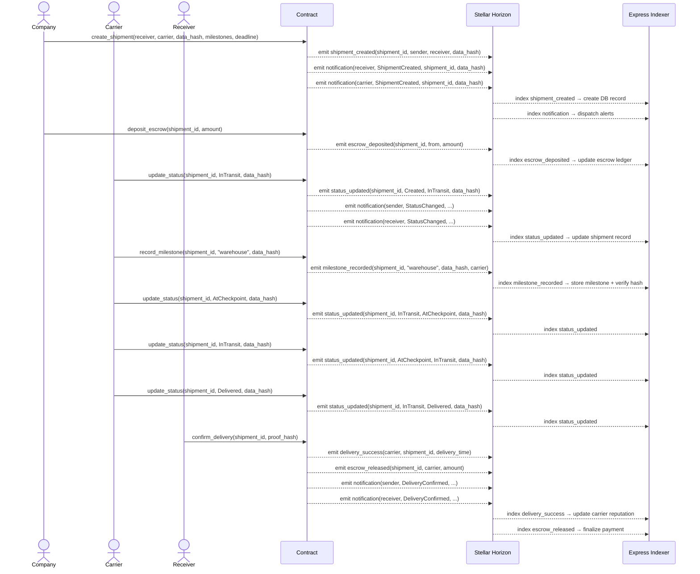
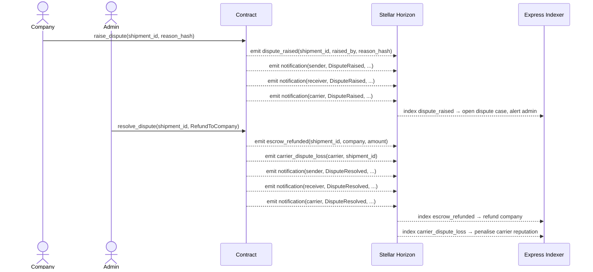
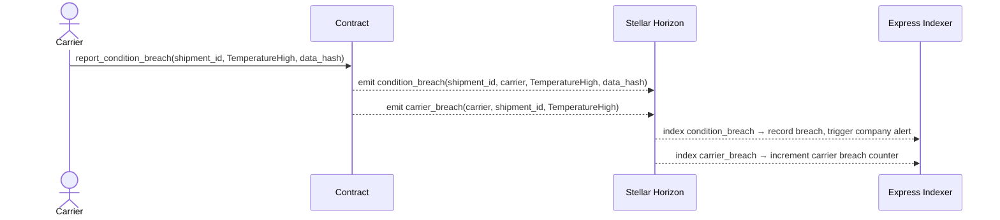
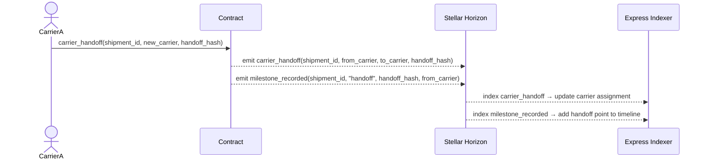
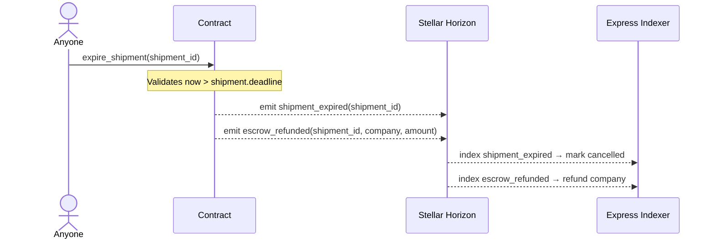

# Shipment Contract — Event Schema Reference

> **Architecture note:** Navin uses a **Hash-and-Emit** pattern. Heavy payloads (GPS traces,
> sensor readings, dispute evidence, milestone metadata) are stored **off-chain**. The contract
> emits only the `shipment_id`, relevant identifiers, and a `BytesN<32>` SHA-256 hash of the
> full payload. The backend indexer verifies integrity by re-hashing the stored payload and
> comparing it against the emitted hash.

---

## Table of Contents

### Shipment Contract

1. [Event Format](#event-format)
2. [Soroban Type Reference](#soroban-type-reference)
3. [Events Index](#events-index)
4. [Shipment Lifecycle Events](#shipment-lifecycle-events)
   - [shipment_created](#shipment_created)
   - [status_updated](#status_updated)
   - [milestone_recorded](#milestone_recorded)
   - [delivery_success](#delivery_success)
   - [shipment_cancelled](#shipment_cancelled)
   - [shipment_expired](#shipment_expired)
5. [Escrow Events](#escrow-events)
   - [escrow_deposited](#escrow_deposited)
   - [escrow_released](#escrow_released)
   - [escrow_refunded](#escrow_refunded)
   - [milestone_payment_released](#milestone_payment_released)
   - [platform_fee_collected](#platform_fee_collected)
   - [escrow_frozen](#escrow_frozen)
6. [Carrier Events](#carrier-events)
   - [carrier_handoff](#carrier_handoff)
   - [condition_breach](#condition_breach)
   - [carrier_breach](#carrier_breach)
   - [carrier_dispute_loss](#carrier_dispute_loss)
   - [carrier_late_delivery](#carrier_late_delivery)
   - [carrier_on_time_delivery](#carrier_on_time_delivery)
   - [carrier_handoff_completed](#carrier_handoff_completed)
   - [carrier_milestone_rate](#carrier_milestone_rate)
   - [carrier_suspended](#carrier_suspended)
   - [carrier_reactivated](#carrier_reactivated)
   - [delivery_confirmed](#delivery_confirmed)
   - [geofence_event](#geofence_event)
   - [eta_updated](#eta_updated)
7. [Dispute Events](#dispute-events)
   - [dispute_raised](#dispute_raised)
   - [dispute_resolved](#dispute_resolved)
   - [evidence_added](#evidence_added)
8. [Admin Events](#admin-events)
   - [admin_proposed](#admin_proposed)
   - [admin_transferred](#admin_transferred)
   - [contract_upgraded](#contract_upgraded)
   - [migration_reported](#migration_reported)
   - [contract_paused](#contract_paused)
   - [contract_unpaused](#contract_unpaused)
   - [force_cancelled](#force_cancelled)
   - [force_released](#force_released)
   - [force_refunded](#force_refunded)
   - [fee_config_updated](#fee_config_updated)
   - [proposal_digest](#proposal_digest)
   - [config_updated](#config_updated)
   - [quota_set](#quota_set)
   - [init](#init)
   - [set_limit](#set_limit)
   - [set_cmp_limit](#set_cmp_limit)
9. [RBAC and Audit Events](#rbac-and-audit-events)
   - [role_revoked](#role_revoked)
   - [role_changed](#role_changed)
   - [add_wl](#add_wl)
   - [rm_wl](#rm_wl)
   - [audit_role_assigned](#audit_role_assigned)
   - [audit_role_revoked](#audit_role_revoked)
   - [audit_role_suspended](#audit_role_suspended)
   - [audit_role_reactivated](#audit_role_reactivated)
   - [audit_admin_transferred](#audit_admin_transferred)
   - [audit_carrier_whitelisted](#audit_carrier_whitelisted)
   - [audit_carrier_unwhitelisted](#audit_carrier_unwhitelisted)
   - [audit_company_suspended](#audit_company_suspended)
   - [audit_company_reactivated](#audit_company_reactivated)
   - [audit_carrier_suspended](#audit_carrier_suspended)
   - [audit_carrier_reactivated](#audit_carrier_reactivated)
10. [Multisig Events](#multisig-events)
    - [ms_init](#ms_init)
    - [approve](#approve-multisig)
    - [executed](#executed)
11. [Notification Events](#notification-events)
   - [notification](#notification)
12. [Lifecycle Sequence Diagram](#lifecycle-sequence-diagram)
13. [TypeScript Type Definitions](#typescript-type-definitions)

### Token Contract

12. [Token Transfer Events](#token-transfer-events)
    - [init](#token-init)
    - [transfer](#token-transfer)
    - [tr_from](#token-transfer-from)
    - [approve](#token-approve)
    - [inc_alw](#token-increase-allowance)
    - [dec_alw](#token-decrease-allowance)
13. [Token Supply Events](#token-supply-events)
    - [mint](#token-mint)
    - [burn](#token-burn)
    - [adm_burn](#token-admin-burn)
    - [burn_from](#token-burn-from)
14. [Token Admin Events](#token-admin-events)
    - [admin_pro](#token-admin-proposed)
    - [admin_tr](#token-admin-transfer)
    - [paused](#token-paused)
    - [unpaused](#token-unpaused)
15. [Token Metadata Events](#token-metadata-events)
    - [meta_add](#token-metadata-add)
    - [meta_rm](#token-metadata-remove)
    - [meta_set](#token-metadata-set)
    - [meta_del](#token-metadata-delete)
16. [Token Batch Events](#token-batch-events)
    - [batch_leg](#batch_leg)
    - [batch_tr](#batch_tr)
    - [batch_tr](#token-batch-transfer)

---

## Event Format

All events are published via the Soroban SDK's `env.events().publish()` method:

- **Shipment Contract:** `topic: (Symbol,)` — single descriptive symbol for stream filtering.
- **Token Contract:** `topic: (Symbol::new(name), Symbol::new(EVENT_SCHEMA_VERSION_STR))` — 2-element topic tuple carrying the event name symbol and schema version string (e.g., `"v1"`), as defined in [`contracts/token/src/event_topics.rs`](../contracts/token/src/event_topics.rs).

```
data:   (field1, field2, ...)    — tuple of typed payload fields
```

When subscribing to Horizon's event stream, filter by `contract_id` and the `topic[0]` symbol
to receive only the relevant event type.

### Schema Version and Idempotency

Shipment lifecycle and escrow settlement events now include three trailing fields:

1. `schema_version: u32` — current value is `2`
2. `event_counter: u32` — monotonically increasing per `shipment_id`
3. `idempotency_key: BytesN<32>` — deterministic hash of `(shipment_id, event_type, event_counter)`

This enables safe parser upgrades and indexer deduplication during contract evolution.

### Migration Guidance (v1 -> v2)

1. Keep legacy decoders for historical events without `schema_version`.
2. For new events, branch parser logic by `schema_version`.
3. Use `idempotency_key` as the primary dedup key in indexer storage.
4. During rollout, allow mixed payloads in the same stream window (older blocks vs new blocks).

---

## Soroban Type Reference

| Soroban Type       | Horizon JSON representation       | Notes                                           |
| ------------------ | --------------------------------- | ----------------------------------------------- |
| `u64`              | `{"u64": "1234"}`                 | Shipment IDs, timestamps, amounts               |
| `i128`             | `{"i128": {"hi": 0, "lo": 1000}}` | Escrow amounts in stroops (1 XLM = 10⁷ stroops) |
| `Address`          | `{"address": "G…"}`               | Stellar account or contract address             |
| `BytesN<32>`       | `{"bytes": "hex…"}`               | 32-byte SHA-256 hash (64 hex chars)             |
| `Symbol`           | `{"symbol": "…"}`                 | Short string identifier (max 32 chars)          |
| `ShipmentStatus`   | `{"enum": N}`                     | Enum variant index (see table below)            |
| `BreachType`       | `{"enum": N}`                     | Enum variant index (see table below)            |
| `NotificationType` | `{"enum": N}`                     | Enum variant index (see table below)            |

### ShipmentStatus Variants

| Variant index | Name           | Description                            |
| ------------- | -------------- | -------------------------------------- |
| 0             | `Created`      | Shipment registered, not yet picked up |
| 1             | `InTransit`    | En route between checkpoints           |
| 2             | `AtCheckpoint` | At an intermediate checkpoint          |
| 3             | `Delivered`    | Delivered to receiver                  |
| 4             | `Disputed`     | Under active dispute                   |
| 5             | `Cancelled`    | Cancelled (terminal)                   |

### BreachType Variants

| Variant index | Name              | Description                           |
| ------------- | ----------------- | ------------------------------------- |
| 0             | `TemperatureHigh` | Temperature exceeded upper limit      |
| 1             | `TemperatureLow`  | Temperature dropped below lower limit |
| 2             | `HumidityHigh`    | Humidity exceeded upper limit         |
| 3             | `Impact`          | Physical shock or drop detected       |
| 4             | `TamperDetected`  | Tamper detection triggered            |

### NotificationType Variants

| Variant index | Name                  | Description                        |
| ------------- | --------------------- | ---------------------------------- |
| 0             | `ShipmentCreated`     | New shipment was created           |
| 1             | `StatusChanged`       | Shipment status transitioned       |
| 2             | `DeliveryConfirmed`   | Delivery confirmed by receiver     |
| 3             | `EscrowReleased`      | Escrowed funds released to carrier |
| 4             | `DisputeRaised`       | A dispute was opened               |
| 5             | `DisputeResolved`     | A dispute was resolved             |
| 6             | `DeadlineApproaching` | Shipment deadline is near          |

---

## Events Index

| Event symbol           | Category  | Emitted by (contract function)                                                |
| ---------------------- | --------- | ----------------------------------------------------------------------------- |
| `shipment_created`     | Lifecycle | `create_shipment`, `create_shipments_batch`                                   |
| `status_updated`       | Lifecycle | `update_status`                                                               |
| `milestone_recorded`   | Lifecycle | `record_milestone`, `carrier_handoff`                                         |
| `delivery_success`     | Lifecycle | `confirm_delivery`                                                            |
| `shipment_cancelled`   | Lifecycle | `cancel_shipment`                                                             |
| `shipment_expired`     | Lifecycle | `expire_shipment`                                                             |
| `escrow_deposited`     | Escrow    | `deposit_escrow`                                                              |
| `escrow_released`      | Escrow    | `confirm_delivery`, `cancel_shipment`, `resolve_dispute`, `multi_sig_execute` |
| `escrow_refunded`      | Escrow    | `cancel_shipment`, `resolve_dispute`, `expire_shipment`, `multi_sig_execute`  |
| `carrier_handoff`      | Carrier   | `carrier_handoff`                                                             |
| `condition_breach`     | Carrier   | `report_condition_breach`                                                     |
| `carrier_breach`       | Carrier   | `report_condition_breach`                                                     |
| `carrier_dispute_loss` | Carrier   | `resolve_dispute`                                                             |
| `dispute_raised`       | Dispute   | `raise_dispute`                                                               |
| `admin_proposed`       | Admin     | `propose_admin`                                                               |
| `admin_transferred`    | Admin     | `accept_admin`, `multi_sig_execute`                                           |
| `contract_upgraded`    | Admin     | `upgrade_contract`, `multi_sig_execute`                                       |
| `migration_reported`   | Admin     | `upgrade`                                                                      |
| `contract_paused`      | Admin     | `pause`                                                                         |
| `contract_unpaused`    | Admin     | `unpause`                                                                       |
| `force_cancelled`      | Admin     | `force_cancel_shipment`                                                         |
| `force_released`       | Admin     | `execute_proposal`                                                              |
| `force_refunded`       | Admin     | `execute_proposal`                                                              |
| `fee_config_updated`   | Admin     | `set_platform_fee`                                                              |
| `proposal_digest`      | Admin     | `propose_action`                                                                |
| `config_updated`       | Admin     | `update_config`, `set_circuit_breaker_config`                                  |
| `quota_set`            | Admin     | `set_creation_quota`                                                            |
| `init`                 | Admin     | `initialize`                                                                  |
| `set_limit`            | Admin     | `set_shipment_limit`                                                          |
| `set_cmp_limit`        | Admin     | `set_company_shipment_limit`                                                  |
| `milestone_payment_released` | Escrow | `record_milestone`, `record_milestones_batch`, `release_milestone_payment` |
| `platform_fee_collected` | Escrow  | `deposit_escrow`                                                               |
| `escrow_frozen`        | Escrow    | `update_status`, `raise_dispute`                                               |
| `dispute_resolved`     | Dispute   | `resolve_dispute`                                                              |
| `evidence_added`       | Dispute   | `add_dispute_evidence`                                                         |
| `carrier_late_delivery` | Carrier  | `confirm_delivery`, `confirm_partial_delivery`                                |
| `carrier_on_time_delivery` | Carrier | `confirm_delivery`, `confirm_partial_delivery`                               |
| `carrier_handoff_completed` | Carrier | `handoff_shipment`                                                            |
| `carrier_milestone_rate` | Carrier  | `confirm_delivery`, `confirm_partial_delivery`                                |
| `carrier_suspended`    | Carrier   | `suspend_carrier`                                                              |
| `carrier_reactivated`  | Carrier   | `reactivate_carrier`                                                           |
| `delivery_confirmed`  | Carrier   | `confirm_delivery`, `confirm_partial_delivery`                                |
| `geofence_event`       | Carrier   | `report_geofence_event`                                                        |
| `eta_updated`          | Carrier   | `update_eta`                                                                   |
| `role_revoked`         | RBAC      | `revoke_role`                                                                  |
| `role_changed`         | RBAC      | `add_company`, `add_carrier`, `add_guardian`, `add_operator`, `revoke_role`, `suspend_role`, `reactivate_role`, `suspend_company`, `reactivate_company` |
| `add_wl`               | RBAC      | `add_carrier_to_whitelist`                                                     |
| `rm_wl`                | RBAC      | `remove_carrier_from_whitelist`                                                |
| `audit_role_assigned`  | Audit     | `add_company`, `add_carrier`, `add_guardian`, `add_operator`                  |
| `audit_role_revoked`   | Audit     | `revoke_role`                                                                  |
| `audit_role_suspended` | Audit     | `suspend_role`                                                                 |
| `audit_role_reactivated` | Audit   | `reactivate_role`                                                              |
| `audit_admin_transferred` | Audit  | `accept_admin_transfer`                                                       |
| `audit_carrier_whitelisted` | Audit | `add_carrier_to_whitelist`                                                    |
| `audit_carrier_unwhitelisted` | Audit | `remove_carrier_from_whitelist`                                               |
| `audit_company_suspended` | Audit  | `suspend_company`                                                              |
| `audit_company_reactivated` | Audit | `reactivate_company`                                                          |
| `audit_carrier_suspended` | Audit   | `suspend_carrier`                                                              |
| `audit_carrier_reactivated` | Audit | `reactivate_carrier`                                                          |
| `ms_init`              | Multisig  | `init_multisig`                                                                |
| `approve`              | Multisig  | `approve_action`                                                               |
| `executed`             | Multisig  | `execute_proposal`                                                             |
| `notification`         | System    | Multiple — see [notification](#notification)                                  |

---

## Shipment Lifecycle Events

### `shipment_created`

Emitted when a company registers a new shipment on-chain.

**Topic:** `"shipment_created"`
**Emitted by:** `create_shipment`, `create_shipments_batch`
**Caller role:** Company

| #   | Field         | Soroban Type | Description                                            |
| --- | ------------- | ------------ | ------------------------------------------------------ |
| 1   | `shipment_id` | `u64`        | Unique on-chain shipment identifier (auto-incremented) |
| 2   | `sender`      | `Address`    | Company address that created the shipment              |
| 3   | `receiver`    | `Address`    | Intended recipient of the goods                        |
| 4   | `data_hash`   | `BytesN<32>` | SHA-256 hash of the full off-chain shipment payload    |

**Backend action:** Create the initial shipment record in the database; link `shipment_id` to the off-chain payload.
**Frontend action:** Display real-time shipment creation notification.

**Co-emitted events:** Two `notification` events are published in the same transaction — one to the `receiver` and one to the `carrier` — both with `NotificationType::ShipmentCreated`.

---

### `status_updated`

Emitted on every valid lifecycle state transition.

**Topic:** `"status_updated"`
**Emitted by:** `update_status`
**Caller role:** Carrier or Admin

| #   | Field         | Soroban Type     | Description                                          |
| --- | ------------- | ---------------- | ---------------------------------------------------- |
| 1   | `shipment_id` | `u64`            | Shipment whose status changed                        |
| 2   | `old_status`  | `ShipmentStatus` | Previous lifecycle state                             |
| 3   | `new_status`  | `ShipmentStatus` | New lifecycle state after transition                 |
| 4   | `data_hash`   | `BytesN<32>`     | SHA-256 hash of the updated off-chain status payload |

**Valid transitions:**

```
Created ──► InTransit ──► AtCheckpoint ──► InTransit (loop)
                  │               │
                  ▼               ▼
              Delivered       Delivered
                  │
                  ▼
             Disputed ──► Cancelled
                      └─► Delivered

Any non-terminal state ──► Cancelled
Any non-terminal, non-Cancelled state ──► Disputed
```

**Backend action:** Update shipment status in DB and trigger webhooks.
**Frontend action:** Refresh shipment timeline in the tracking UI.

**Co-emitted events:** Two `notification` events (to `sender` and `receiver`) with `NotificationType::StatusChanged`.

---

### `milestone_recorded`

Emitted when a carrier reports a transit checkpoint. The full milestone payload (GPS, temperature, photos) lives off-chain; only its hash is published.

**Topic:** `"milestone_recorded"`
**Emitted by:** `record_milestone`, `carrier_handoff`
**Caller role:** Carrier

| #   | Field         | Soroban Type | Description                                                   |
| --- | ------------- | ------------ | ------------------------------------------------------------- |
| 1   | `shipment_id` | `u64`        | Shipment this milestone belongs to                            |
| 2   | `checkpoint`  | `Symbol`     | Human-readable checkpoint name (e.g. `"warehouse"`, `"port"`) |
| 3   | `data_hash`   | `BytesN<32>` | SHA-256 hash of the full off-chain milestone payload          |
| 4   | `reporter`    | `Address`    | Carrier address that recorded the milestone                   |

**Backend action:** Store the full milestone record and verify hash integrity.
**Frontend action:** Add a new point to the shipment tracking map.

> **Note:** During a `carrier_handoff`, a milestone is automatically recorded with the checkpoint symbol set to `"handoff"` to mark the custody transfer point in the timeline.

---

### `delivery_success`

Emitted when the receiver confirms that a shipment has been successfully delivered. Used by the analytics pipeline to compute carrier punctuality metrics.

**Topic:** `"delivery_success"`
**Emitted by:** `confirm_delivery`
**Caller role:** Receiver

| #   | Field           | Soroban Type | Description                                 |
| --- | --------------- | ------------ | ------------------------------------------- |
| 1   | `carrier`       | `Address`    | Carrier that completed the delivery         |
| 2   | `shipment_id`   | `u64`        | Shipment that was delivered                 |
| 3   | `delivery_time` | `u64`        | Ledger timestamp (Unix seconds) at delivery |

**Backend action:** Increment the carrier's on-time delivery counter in the reputation index. If `delivery_time ≤ shipment.deadline`, this counts as an on-time delivery.

**Co-emitted events:**

- `escrow_released` — escrowed funds (or milestone portion) paid to carrier
- Two `notification` events (to `sender` and `receiver`) with `NotificationType::DeliveryConfirmed`

---

### `shipment_cancelled`

Emitted when a company or admin cancels a shipment.

**Topic:** `"shipment_cancelled"`
**Emitted by:** `cancel_shipment`
**Caller role:** Company (own shipments) or Admin

| #   | Field         | Soroban Type | Description                                       |
| --- | ------------- | ------------ | ------------------------------------------------- |
| 1   | `shipment_id` | `u64`        | Cancelled shipment identifier                     |
| 2   | `caller`      | `Address`    | Company or Admin address that cancelled           |
| 3   | `reason_hash` | `BytesN<32>` | SHA-256 hash of the off-chain cancellation reason |

**Backend action:** Mark shipment as cancelled; refund any escrowed funds to the company.

**Co-emitted events:** `escrow_refunded` (if escrow was held).

---

### `shipment_expired`

Emitted when a shipment misses its deadline and is auto-cancelled via the `expire_shipment` function.

**Topic:** `"shipment_expired"`
**Emitted by:** `expire_shipment`
**Caller role:** Anyone (permissionless) — the function checks `now > shipment.deadline`

| #   | Field         | Soroban Type | Description                 |
| --- | ------------- | ------------ | --------------------------- |
| 1   | `shipment_id` | `u64`        | Expired shipment identifier |

**Backend action:** Mark shipment expired/cancelled; trigger refund flow.

**Co-emitted events:** `escrow_refunded` (if escrow was held).

---

## Escrow Events

### `escrow_deposited`

Emitted when a company locks funds into escrow for a shipment.

**Topic:** `"escrow_deposited"`
**Emitted by:** `deposit_escrow`
**Caller role:** Company

| #   | Field         | Soroban Type | Description                              |
| --- | ------------- | ------------ | ---------------------------------------- |
| 1   | `shipment_id` | `u64`        | Shipment the escrow is associated with   |
| 2   | `from`        | `Address`    | Company address that deposited the funds |
| 3   | `amount`      | `i128`       | Amount deposited in stroops              |

**Constraint:** Escrow can only be deposited when `shipment.status == Created` and no prior escrow is held.

**Backend action:** Update escrow ledger and notify the carrier.
**Frontend action:** Show escrow status on the shipment detail page.

---

### `escrow_released`

Emitted when escrowed funds are paid out to the carrier.

**Topic:** `"escrow_released"`
**Emitted by:** `confirm_delivery` (via `internal_release_escrow`), `cancel_shipment` (sender refund path), `resolve_dispute`, `multi_sig_execute`
**Recipient:** Carrier (in normal delivery/dispute-win path); Sender (in cancel path where sender is recipient)

| #   | Field         | Soroban Type | Description                          |
| --- | ------------- | ------------ | ------------------------------------ |
| 1   | `shipment_id` | `u64`        | Shipment the escrow was held for     |
| 2   | `to`          | `Address`    | Address receiving the released funds |
| 3   | `amount`      | `i128`       | Amount released in stroops           |

**Backend action:** Finalize payment record; trigger settlement.
**Frontend action:** Confirm payment completion to both parties.

---

### `escrow_refunded`

Emitted when escrowed funds are returned to the company (e.g., cancellation, expiry, or dispute lost by carrier).

**Topic:** `"escrow_refunded"`
**Emitted by:** `cancel_shipment`, `resolve_dispute` (RefundToCompany path), `expire_shipment`, `multi_sig_execute`
**Recipient:** Company (shipment sender)

| #   | Field         | Soroban Type | Description                          |
| --- | ------------- | ------------ | ------------------------------------ |
| 1   | `shipment_id` | `u64`        | Shipment the escrow was held for     |
| 2   | `to`          | `Address`    | Company address receiving the refund |
| 3   | `amount`      | `i128`       | Amount refunded in stroops           |

**Backend action:** Update escrow ledger and notify company.
**Frontend action:** Show refund status on shipment detail page.

---

## Carrier Events

### `carrier_handoff`

Emitted when custody of a shipment is transferred between carriers.

**Topic:** `"carrier_handoff"`
**Emitted by:** `carrier_handoff`
**Caller role:** Current carrier

| #   | Field          | Soroban Type | Description                                |
| --- | -------------- | ------------ | ------------------------------------------ |
| 1   | `shipment_id`  | `u64`        | Shipment being handed off                  |
| 2   | `from_carrier` | `Address`    | Current carrier handing off the shipment   |
| 3   | `to_carrier`   | `Address`    | New carrier receiving the shipment         |
| 4   | `handoff_hash` | `BytesN<32>` | SHA-256 hash of the off-chain handoff data |

**Backend action:** Update carrier assignment; trigger carrier change notifications.
**Frontend action:** Display carrier transition in the shipment tracking UI.

**Co-emitted events:** A `milestone_recorded` event is automatically emitted with checkpoint `"handoff"` to mark the custody transfer in the milestone timeline.

---

### `condition_breach`

Emitted when a carrier detects an out-of-range sensor reading. The full sensor payload remains off-chain; only the hash is emitted.

**Topic:** `"condition_breach"`
**Emitted by:** `report_condition_breach`
**Caller role:** Carrier

| #   | Field         | Soroban Type | Description                                       |
| --- | ------------- | ------------ | ------------------------------------------------- |
| 1   | `shipment_id` | `u64`        | Shipment where the breach occurred                |
| 2   | `carrier`     | `Address`    | Carrier that reported the breach                  |
| 3   | `breach_type` | `BreachType` | Category of the condition breach                  |
| 4   | `data_hash`   | `BytesN<32>` | SHA-256 hash of the off-chain sensor data payload |

**Backend action:** Record the breach event; trigger alerts to company and receiver.
**Frontend action:** Flag the shipment with a condition-breach warning badge.

**Co-emitted events:** `carrier_breach` — a reputation-specific event emitted alongside this one for the analytics pipeline.

---

### `carrier_breach`

Emitted alongside `condition_breach` as a carrier-keyed analytics signal. The backend indexes this event separately, keyed by carrier address, to maintain the carrier reputation score.

**Topic:** `"carrier_breach"`
**Emitted by:** `report_condition_breach`
**Caller role:** Carrier

| #   | Field         | Soroban Type | Description                                   |
| --- | ------------- | ------------ | --------------------------------------------- |
| 1   | `carrier`     | `Address`    | Carrier that reported (and caused) the breach |
| 2   | `shipment_id` | `u64`        | Shipment where the breach occurred            |
| 3   | `breach_type` | `BreachType` | Category of the condition breach              |

**Backend action:** Increment breach counter in the carrier's reputation record.

> **Note on field order:** The `carrier` address appears as field 1 (unlike `condition_breach` where `shipment_id` is first) to allow efficient indexing by carrier key.

---

### `carrier_dispute_loss`

Emitted when a dispute is resolved against the carrier (i.e., the admin chooses `DisputeResolution::RefundToCompany`). Used by the analytics pipeline to penalise the carrier's reputation score.

**Topic:** `"carrier_dispute_loss"`
**Emitted by:** `resolve_dispute`
**Caller role:** Admin

| #   | Field         | Soroban Type | Description                        |
| --- | ------------- | ------------ | ---------------------------------- |
| 1   | `carrier`     | `Address`    | Carrier that lost the dispute      |
| 2   | `shipment_id` | `u64`        | Shipment the dispute was raised on |

**Backend action:** Increment dispute-loss counter in the carrier reputation index.

---

## Dispute Events

### `dispute_raised`

Emitted when a party formally disputes a shipment. The full dispute description (text, evidence, photos) is stored off-chain; only the SHA-256 hash is published for tamper-proof auditability.

**Topic:** `"dispute_raised"`
**Emitted by:** `raise_dispute`
**Caller role:** Company or Carrier

| #   | Field         | Soroban Type | Description                                    |
| --- | ------------- | ------------ | ---------------------------------------------- |
| 1   | `shipment_id` | `u64`        | Shipment under dispute                         |
| 2   | `raised_by`   | `Address`    | Address that initiated the dispute             |
| 3   | `reason_hash` | `BytesN<32>` | SHA-256 hash of the off-chain dispute evidence |

**Backend action:** Create a dispute case and alert the admin.
**Frontend action:** Open the dispute resolution workflow for both parties.

**Co-emitted events:** Three `notification` events — one each to `sender`, `receiver`, and `carrier` — with `NotificationType::DisputeRaised`.

---

## Admin Events

### `admin_proposed`

Emitted when the current admin nominates a new administrator via the two-step transfer process.

**Topic:** `"admin_proposed"`
**Emitted by:** `propose_admin`
**Caller role:** Admin

| #   | Field            | Soroban Type | Description                     |
| --- | ---------------- | ------------ | ------------------------------- |
| 1   | `current_admin`  | `Address`    | Address of the nominating admin |
| 2   | `proposed_admin` | `Address`    | Address being nominated         |

**Backend action:** Record the pending admin transfer.

---

### `admin_transferred`

Emitted when the proposed admin accepts the role (completing the two-step handover) or when a multi-sig proposal executes a `TransferAdmin` action.

**Topic:** `"admin_transferred"`
**Emitted by:** `accept_admin`, `multi_sig_execute`
**Caller role:** Proposed admin (for `accept_admin`); any admin (for `multi_sig_execute` after threshold reached)

| #   | Field       | Soroban Type | Description                   |
| --- | ----------- | ------------ | ----------------------------- |
| 1   | `old_admin` | `Address`    | Previous admin address        |
| 2   | `new_admin` | `Address`    | Newly confirmed admin address |

**Backend action:** Update admin record and invalidate any pending proposals from the old admin.

---

### `contract_upgraded`

Emitted when the contract WASM is upgraded.

**Topic:** `"contract_upgraded"`
**Emitted by:** `upgrade_contract`, `multi_sig_execute`
**Caller role:** Admin

| #   | Field           | Soroban Type | Description                      |
| --- | --------------- | ------------ | -------------------------------- |
| 1   | `admin`         | `Address`    | Admin that triggered the upgrade |
| 2   | `new_wasm_hash` | `BytesN<32>` | Hash of the deployed WASM        |
| 3   | `version`       | `u32`        | Contract version after upgrade   |

**Backend action:** Record the new version and WASM hash in the deployment registry.

---

### `init`

Emitted once when the shipment contract is initialized. `init` is the only topic string for this event.

**Topic:** `"init"`
**Emitted by:** `initialize`
**Caller role:** Admin

| #   | Field            | Soroban Type | Description                       |
| --- | ---------------- | ------------ | --------------------------------- |
| 1   | `admin`          | `Address`    | Initial admin address             |
| 2   | `token_contract` | `Address`    | Token contract used for escrow    |

**Backend action:** Record the deployment's admin and token contract.

---

### `set_limit`

Emitted when the admin updates the global active-shipment limit. `set_limit` is the only topic string for this event.

**Topic:** `"set_limit"`
**Emitted by:** `set_shipment_limit`
**Caller role:** Admin

| #   | Field   | Soroban Type | Description                       |
| --- | ------- | ------------ | --------------------------------- |
| 1   | `admin` | `Address`    | Admin that changed the limit      |
| 2   | `limit` | `u32`        | New global active-shipment limit  |

**Backend action:** Update the stored global shipment limit.

---

### `set_cmp_limit`

Emitted when the admin sets a company-specific active-shipment limit. `set_cmp_limit` is the only topic string for this event.

**Topic:** `"set_cmp_limit"`
**Emitted by:** `set_company_shipment_limit`
**Caller role:** Admin

| #   | Field     | Soroban Type | Description                            |
| --- | --------- | ------------ | -------------------------------------- |
| 1   | `admin`   | `Address`    | Admin that changed the limit           |
| 2   | `company` | `Address`    | Company the override applies to        |
| 3   | `limit`   | `u32`        | New active-shipment limit for company  |

**Backend action:** Update the stored limit override for the company.

---

## Notification Events

### `notification`

A system-level fan-out event emitted alongside most lifecycle events. The backend indexes this to trigger push notifications, emails, or in-app alerts to specific Stellar addresses.

**Topic:** `"notification"`
**Emitted by:** `create_shipment`, `create_shipments_batch`, `update_status`, `confirm_delivery`, `raise_dispute`, `resolve_dispute`, `expire_shipment`
**Caller role:** Varies (emitted automatically by the contract)

| #   | Field               | Soroban Type       | Description                              |
| --- | ------------------- | ------------------ | ---------------------------------------- |
| 1   | `recipient`         | `Address`          | Address to receive the notification      |
| 2   | `notification_type` | `NotificationType` | Type of notification event               |
| 3   | `shipment_id`       | `u64`              | Related shipment ID                      |
| 4   | `data_hash`         | `BytesN<32>`       | SHA-256 hash of the notification payload |

**Backend action:** Look up the notification preferences for `recipient` and dispatch the appropriate alert channel (push, email, in-app).

**Emission map:**

| Trigger function   | Recipients                | NotificationType    |
| ------------------ | ------------------------- | ------------------- |
| `create_shipment`  | receiver, carrier         | `ShipmentCreated`   |
| `update_status`    | sender, receiver          | `StatusChanged`     |
| `confirm_delivery` | sender, receiver          | `DeliveryConfirmed` |
| `raise_dispute`    | sender, receiver, carrier | `DisputeRaised`     |
| `resolve_dispute`  | sender, receiver, carrier | `DisputeResolved`   |
| `expire_shipment`  | sender, receiver          | `StatusChanged`     |

---

## Additional Shipment Events

The following topic sections complement the lifecycle reference above. Payload fields are
listed in the exact order published by the contract; each event uses the single-symbol tuple
shown in its topic.

### `milestone_payment_released`

**Topic tuple:** `(Symbol("milestone_payment_released"),)`
**Emitted by:** `record_milestone`, `record_milestones_batch`, `release_milestone_payment`

| # | Field | Soroban Type | Description |
|---|---|---|---|
| 1 | `shipment_id` | `u64` | Shipment whose milestone triggered payment |
| 2 | `status` | `ShipmentStatus` | Always `InTransit` |
| 3 | `data_hash` | `BytesN<32>` | Hash of the shipment, recipient, amount, and milestone |
| 4 | `timestamp` | `u64` | Ledger timestamp of the release |
| 5 | `actor` | `Address` | Carrier receiving the payment |
| 6 | `milestone` | `Symbol` | Payment milestone name |
| 7 | `amount` | `i128` | Amount released in stroops |

### `platform_fee_collected`

**Topic tuple:** `(Symbol("platform_fee_collected"),)`
**Emitted by:** `deposit_escrow`

| # | Field | Soroban Type | Description |
|---|---|---|---|
| 1 | `shipment_id` | `u64` | Shipment associated with the fee |
| 2 | `status` | `ShipmentStatus` | Always `Created` |
| 3 | `data_hash` | `BytesN<32>` | Hash of shipment, treasury, and fee amount |
| 4 | `timestamp` | `u64` | Ledger timestamp of collection |
| 5 | `actor` | `Address` | Treasury receiving the fee |
| 6 | `amount` | `i128` | Fee collected in stroops |

### `escrow_frozen`

**Topic tuple:** `(Symbol("escrow_frozen"),)`
**Emitted by:** `update_status`, `raise_dispute`

| # | Field | Soroban Type | Description |
|---|---|---|---|
| 1 | `shipment_id` | `u64` | Shipment whose escrow was frozen |
| 2 | `reason` | `EscrowFreezeReason` | Structured freeze reason |
| 3 | `caller` | `Address` | Address that triggered the freeze |
| 4 | `timestamp` | `u64` | Ledger timestamp of the freeze |

### `dispute_resolved`

**Topic tuple:** `(Symbol("dispute_resolved"),)`
**Emitted by:** `resolve_dispute`

| # | Field | Soroban Type | Description |
|---|---|---|---|
| 1 | `shipment_id` | `u64` | Resolved shipment |
| 2 | `resolution` | `DisputeResolution` | `ReleaseToCarrier`, `RefundToCompany`, or `PartialRefund` |
| 3 | `reason_hash` | `BytesN<32>` | Hash of the off-chain settlement rationale |
| 4 | `admin` | `Address` | Admin that resolved the dispute |

### `evidence_added`

**Topic tuple:** `(Symbol("evidence_added"),)`
**Emitted by:** `add_dispute_evidence`

| # | Field | Soroban Type | Description |
|---|---|---|---|
| 1 | `shipment_id` | `u64` | Shipment whose dispute received evidence |
| 2 | `submitted_by` | `Address` | Address that submitted the evidence |
| 3 | `index` | `u32` | Zero-based evidence index |
| 4 | `evidence_hash` | `BytesN<32>` | Hash of the off-chain evidence document |

### `carrier_late_delivery`

**Topic tuple:** `(Symbol("carrier_late_delivery"),)`
**Emitted by:** `confirm_delivery`, `confirm_partial_delivery`

| # | Field | Soroban Type | Description |
|---|---|---|---|
| 1 | `carrier` | `Address` | Carrier that delivered late |
| 2 | `shipment_id` | `u64` | Delivered shipment |
| 3 | `deadline` | `u64` | Shipment deadline |
| 4 | `actual_delivery_time` | `u64` | Actual delivery timestamp |

### `carrier_on_time_delivery`

**Topic tuple:** `(Symbol("carrier_on_time_delivery"),)`
**Emitted by:** `confirm_delivery`, `confirm_partial_delivery`

| # | Field | Soroban Type | Description |
|---|---|---|---|
| 1 | `carrier` | `Address` | Carrier that delivered on time |
| 2 | `shipment_id` | `u64` | Delivered shipment |

### `carrier_handoff_completed`

**Topic tuple:** `(Symbol("carrier_handoff_completed"),)`
**Emitted by:** `handoff_shipment`

| # | Field | Soroban Type | Description |
|---|---|---|---|
| 1 | `from_carrier` | `Address` | Carrier handing off the shipment |
| 2 | `to_carrier` | `Address` | Carrier receiving the shipment |
| 3 | `shipment_id` | `u64` | Shipment handed off |

### `carrier_milestone_rate`

**Topic tuple:** `(Symbol("carrier_milestone_rate"),)`
**Emitted by:** `confirm_delivery`, `confirm_partial_delivery`

| # | Field | Soroban Type | Description |
|---|---|---|---|
| 1 | `carrier` | `Address` | Carrier whose milestone rate is reported |
| 2 | `shipment_id` | `u64` | Shipment being measured |
| 3 | `milestones_hit` | `u32` | Number of milestones completed |
| 4 | `total_milestones` | `u32` | Total configured milestones |

### `carrier_suspended`

**Topic tuple:** `(Symbol("carrier_suspended"),)`
**Emitted by:** `suspend_carrier`

| # | Field | Soroban Type | Description |
|---|---|---|---|
| 1 | `admin` | `Address` | Admin or operator suspending the carrier |
| 2 | `carrier` | `Address` | Suspended carrier |

### `carrier_reactivated`

**Topic tuple:** `(Symbol("carrier_reactivated"),)`
**Emitted by:** `reactivate_carrier`

| # | Field | Soroban Type | Description |
|---|---|---|---|
| 1 | `admin` | `Address` | Admin or operator reactivating the carrier |
| 2 | `carrier` | `Address` | Reactivated carrier |

### `delivery_confirmed`

**Topic tuple:** `(Symbol("delivery_confirmed"),)`
**Emitted by:** `confirm_delivery`, `confirm_partial_delivery`

| # | Field | Soroban Type | Description |
|---|---|---|---|
| 1 | `shipment_id` | `u64` | Delivered shipment |
| 2 | `status` | `ShipmentStatus` | Always `Delivered` |
| 3 | `data_hash` | `BytesN<32>` | Hash of the delivery confirmation |
| 4 | `timestamp` | `u64` | Ledger timestamp of confirmation |
| 5 | `actor` | `Address` | Receiver confirming delivery |

### `geofence_event`

**Topic tuple:** `(Symbol("geofence_event"),)`
**Emitted by:** `report_geofence_event`

| # | Field | Soroban Type | Description |
|---|---|---|---|
| 1 | `shipment_id` | `u64` | Shipment associated with the geofence event |
| 2 | `zone_type` | `GeofenceEvent` | `ZoneEntry`, `ZoneExit`, or `RouteDeviation` |
| 3 | `data_hash` | `BytesN<32>` | Hash of the off-chain location data |
| 4 | `timestamp` | `u64` | Ledger timestamp of the event |
| 5 | `actor` | `Address` | Carrier reporting the event |

### `eta_updated`

**Topic tuple:** `(Symbol("eta_updated"),)`
**Emitted by:** `update_eta`

| # | Field | Soroban Type | Description |
|---|---|---|---|
| 1 | `shipment_id` | `u64` | Shipment whose ETA changed |
| 2 | `status` | `ShipmentStatus` | Always `InTransit` |
| 3 | `data_hash` | `BytesN<32>` | Hash of the off-chain ETA data |
| 4 | `timestamp` | `u64` | Ledger timestamp of the update |
| 5 | `actor` | `Address` | Carrier updating the ETA |
| 6 | `new_eta` | `u64` | New estimated arrival timestamp |

### `migration_reported`

**Topic tuple:** `(Symbol("migration_reported"),)`
**Emitted by:** `upgrade`

| # | Field | Soroban Type | Description |
|---|---|---|---|
| 1 | `current_version` | `u32` | Contract version before migration |
| 2 | `target_version` | `u32` | Contract version after migration |
| 3 | `affected_shipments` | `u64` | Number of shipment entries affected or estimated |

### `contract_paused`

**Topic tuple:** `(Symbol("contract_paused"),)`
**Emitted by:** `pause`

| # | Field | Soroban Type | Description |
|---|---|---|---|
| 1 | `admin` | `Address` | Admin that paused the contract |
| 2 | `timestamp` | `u64` | Ledger timestamp when pause occurred |

### `contract_unpaused`

**Topic tuple:** `(Symbol("contract_unpaused"),)`
**Emitted by:** `unpause`

| # | Field | Soroban Type | Description |
|---|---|---|---|
| 1 | `admin` | `Address` | Admin that unpaused the contract |
| 2 | `timestamp` | `u64` | Ledger timestamp when unpause occurred |

### `force_cancelled`

**Topic tuple:** `(Symbol("force_cancelled"),)`
**Emitted by:** `force_cancel_shipment`

| # | Field | Soroban Type | Description |
|---|---|---|---|
| 1 | `shipment_id` | `u64` | Forcibly cancelled shipment |
| 2 | `status` | `ShipmentStatus` | Always `Cancelled` |
| 3 | `data_hash` | `BytesN<32>` | Hash of the mandatory off-chain reason document |
| 4 | `timestamp` | `u64` | Ledger timestamp of the force-cancel |
| 5 | `actor` | `Address` | Admin or multisig proposer |
| 6 | `escrow_refunded` | `i128` | Amount refunded in stroops |

### `force_released`

**Topic tuple:** `(Symbol("force_released"),)`
**Emitted by:** `execute_proposal`

| # | Field | Soroban Type | Description |
|---|---|---|---|
| 1 | `shipment_id` | `u64` | Shipment whose escrow was released |
| 2 | `status` | `ShipmentStatus` | Always `Delivered` |
| 3 | `data_hash` | `BytesN<32>` | Hash of the mandatory off-chain reason document |
| 4 | `timestamp` | `u64` | Ledger timestamp of the force-release |
| 5 | `actor` | `Address` | Admin authorizing the release |
| 6 | `escrow_released` | `i128` | Amount released in stroops |

### `force_refunded`

**Topic tuple:** `(Symbol("force_refunded"),)`
**Emitted by:** `execute_proposal`

| # | Field | Soroban Type | Description |
|---|---|---|---|
| 1 | `shipment_id` | `u64` | Shipment whose escrow was refunded |
| 2 | `status` | `ShipmentStatus` | Always `Cancelled` |
| 3 | `data_hash` | `BytesN<32>` | Hash of the mandatory off-chain reason document |
| 4 | `timestamp` | `u64` | Ledger timestamp of the force-refund |
| 5 | `actor` | `Address` | Admin authorizing the refund |
| 6 | `escrow_refunded` | `i128` | Amount refunded in stroops |

### `fee_config_updated`

**Topic tuple:** `(Symbol("fee_config_updated"),)`
**Emitted by:** `set_platform_fee`

| # | Field | Soroban Type | Description |
|---|---|---|---|
| 1 | `admin` | `Address` | Admin changing the fee configuration |
| 2 | `fee_bps` | `u32` | New fee rate in basis points |
| 3 | `treasury` | `Address` | Address receiving platform fees |

### `proposal_digest`

**Topic tuple:** `(Symbol("proposal_digest"),)`
**Emitted by:** `propose_action`

| # | Field | Soroban Type | Description |
|---|---|---|---|
| 1 | `proposal_id` | `u64` | Proposal identifier |
| 2 | `digest` | `BytesN<32>` | Canonical proposal digest |
| 3 | `computed_at` | `u64` | Ledger timestamp when the digest was computed |

### `config_updated`

**Topic tuple:** `(Symbol("config_updated"),)`
**Emitted by:** `update_config`, `set_circuit_breaker_config`

`update_config` publishes these fields in order:

| # | Field | Soroban Type | Description |
|---|---|---|---|
| 1 | `admin` | `Address` | Admin changing the contract configuration |
| 2 | `new_config` | `ContractConfig` | Complete replacement contract configuration |

`set_circuit_breaker_config` publishes a separate payload shape:

| # | Field | Soroban Type | Description |
|---|---|---|---|
| 1 | `config_type` | `Symbol` | Always `"circuit_breaker"` |
| 2 | `failure_threshold` | `u32` | Failures before opening the breaker |
| 3 | `recovery_timeout` | `u64` | Recovery timeout in seconds |
| 4 | `half_open_max_requests` | `u32` | Requests allowed while half-open |
| 5 | `schema_version` | `u32` | Event schema version (`2`) |
| 6 | `event_counter` | `u32` | Monotonic global event counter |
| 7 | `idempotency_key` | `BytesN<32>` | Deterministic event idempotency key |

### `quota_set`

**Topic tuple:** `(Symbol("quota_set"),)`
**Emitted by:** `set_creation_quota`

| # | Field | Soroban Type | Description |
|---|---|---|---|
| 1 | `company` | `Address` | Company whose quota is configured |
| 2 | `count` | `u32` | Maximum creations allowed in the window |
| 3 | `window_start` | `u64` | Configured window duration in seconds |

### `role_revoked`

**Topic tuple:** `(Symbol("role_revoked"),)`
**Emitted by:** `revoke_role`

| # | Field | Soroban Type | Description |
|---|---|---|---|
| 1 | `admin` | `Address` | Admin performing the revocation |
| 2 | `target` | `Address` | Address whose role was revoked |
| 3 | `role` | `Role` | Revoked role |

### `role_changed`

**Topic tuple:** `(Symbol("role_changed"),)`
**Emitted by:** `add_company`, `add_carrier`, `add_guardian`, `add_operator`, `revoke_role`, `suspend_role`, `reactivate_role`, `suspend_company`, `reactivate_company`

| # | Field | Soroban Type | Description |
|---|---|---|---|
| 1 | `action` | `RoleChangeAction` | `Assigned`, `Revoked`, `Suspended`, or `Reactivated` |
| 2 | `admin` | `Address` | Address performing the role change |
| 3 | `target` | `Address` | Address whose role changed |
| 4 | `role` | `Role` | Affected role |
| 5 | `timestamp` | `u64` | Ledger timestamp of the change |

### `add_wl`

**Topic tuple:** `(Symbol("add_wl"),)`
**Emitted by:** `add_carrier_to_whitelist`

| # | Field | Soroban Type | Description |
|---|---|---|---|
| 1 | `company` | `Address` | Company adding a carrier |
| 2 | `carrier` | `Address` | Carrier added to the whitelist |
| 3 | `schema_version` | `u32` | Event schema version (`2`) |
| 4 | `event_counter` | `u32` | Monotonic global event counter |
| 5 | `idempotency_key` | `BytesN<32>` | Deterministic event idempotency key |

### `rm_wl`

**Topic tuple:** `(Symbol("rm_wl"),)`
**Emitted by:** `remove_carrier_from_whitelist`

| # | Field | Soroban Type | Description |
|---|---|---|---|
| 1 | `company` | `Address` | Company removing a carrier |
| 2 | `carrier` | `Address` | Carrier removed from the whitelist |
| 3 | `schema_version` | `u32` | Event schema version (`2`) |
| 4 | `event_counter` | `u32` | Monotonic global event counter |
| 5 | `idempotency_key` | `BytesN<32>` | Deterministic event idempotency key |

### `audit_role_assigned`

**Topic tuple:** `(Symbol("audit_role_assigned"),)`
**Emitted by:** `add_company`, `add_carrier`, `add_guardian`, `add_operator`

### `audit_role_revoked`

**Topic tuple:** `(Symbol("audit_role_revoked"),)`
**Emitted by:** `revoke_role`

### `audit_role_suspended`

**Topic tuple:** `(Symbol("audit_role_suspended"),)`
**Emitted by:** `suspend_role`

### `audit_role_reactivated`

**Topic tuple:** `(Symbol("audit_role_reactivated"),)`
**Emitted by:** `reactivate_role`

### `audit_admin_transferred`

**Topic tuple:** `(Symbol("audit_admin_transferred"),)`
**Emitted by:** `accept_admin_transfer`

### `audit_carrier_whitelisted`

**Topic tuple:** `(Symbol("audit_carrier_whitelisted"),)`
**Emitted by:** `add_carrier_to_whitelist`

### `audit_carrier_unwhitelisted`

**Topic tuple:** `(Symbol("audit_carrier_unwhitelisted"),)`
**Emitted by:** `remove_carrier_from_whitelist`

### `audit_company_suspended`

**Topic tuple:** `(Symbol("audit_company_suspended"),)`
**Emitted by:** `suspend_company`

### `audit_company_reactivated`

**Topic tuple:** `(Symbol("audit_company_reactivated"),)`
**Emitted by:** `reactivate_company`

### `audit_carrier_suspended`

**Topic tuple:** `(Symbol("audit_carrier_suspended"),)`
**Emitted by:** `suspend_carrier`

### `audit_carrier_reactivated`

**Topic tuple:** `(Symbol("audit_carrier_reactivated"),)`
**Emitted by:** `reactivate_carrier`

All eleven audit topics below use the same payload order: `entry_id: u64`,
`actor: Address`, `target: Address`, `timestamp: u64`. The topic name identifies the
audit action; there is no separate action field in the payload.

The common payload tuple is `(entry_id, actor, target, timestamp)`.

### `ms_init`

**Topic tuple:** `(Symbol("ms_init"),)`
**Emitted by:** `init_multisig`

| # | Field | Soroban Type | Description |
|---|---|---|---|
| 1 | `admin_count` | `u32` | Number of configured multisig admins |
| 2 | `threshold` | `u32` | Approvals required to execute a proposal |
| 3 | `schema_version` | `u32` | Event schema version (`2`) |
| 4 | `event_counter` | `u32` | Monotonic global event counter |
| 5 | `idempotency_key` | `BytesN<32>` | Deterministic event idempotency key |

### `approve` (multisig)

The shipment contract's multisig approval topic is also named `approve`; it is distinct
from the token contract's allowance-approval event below.

**Topic tuple:** `(Symbol("approve"),)`
**Emitted by:** `approve_action`

| # | Field | Soroban Type | Description |
|---|---|---|---|
| 1 | `proposal_id` | `u64` | Proposal receiving approval |
| 2 | `approver` | `Address` | Admin approving the proposal |
| 3 | `approval_count` | `u32` | Current number of approvals |
| 4 | `schema_version` | `u32` | Event schema version (`2`) |
| 5 | `event_counter` | `u32` | Monotonic global event counter |
| 6 | `idempotency_key` | `BytesN<32>` | Deterministic event idempotency key |

### `executed`

**Topic tuple:** `(Symbol("executed"),)`
**Emitted by:** `execute_proposal`

| # | Field | Soroban Type | Description |
|---|---|---|---|
| 1 | `proposal_id` | `u64` | Executed proposal |
| 2 | `action` | `AdminAction` | Executed multisig action |
| 3 | `schema_version` | `u32` | Event schema version (`2`) |
| 4 | `event_counter` | `u32` | Monotonic global event counter |
| 5 | `idempotency_key` | `BytesN<32>` | Deterministic event idempotency key |

---

## Lifecycle Sequence Diagram

### Happy Path (Shipment Created → Delivered)



---

### Dispute Path



---

### Condition Breach Path



---

### Carrier Handoff Path



---

### Expiry Path



---

## TypeScript Type Definitions

These types describe the decoded event payloads as they appear after parsing Stellar Horizon's event stream for this contract.

```typescript
// ─── Soroban Primitive Aliases ────────────────────────────────────────────────

/** Stellar account or contract address (G… or C… prefixed) */
type StellarAddress = string;

/** u64 encoded as a decimal string to avoid JS integer overflow */
type U64 = string;

/** i128 encoded as a bigint */
type I128 = bigint;

/** 32-byte SHA-256 hash, hex-encoded (64 characters) */
type Hash32 = string;

// ─── Enum Types ───────────────────────────────────────────────────────────────

type ShipmentStatus =
  | "Created"
  | "InTransit"
  | "AtCheckpoint"
  | "Delivered"
  | "Disputed"
  | "Cancelled";

type BreachType =
  | "TemperatureHigh"
  | "TemperatureLow"
  | "HumidityHigh"
  | "Impact"
  | "TamperDetected";

type NotificationType =
  | "ShipmentCreated"
  | "StatusChanged"
  | "DeliveryConfirmed"
  | "EscrowReleased"
  | "DisputeRaised"
  | "DisputeResolved"
  | "DeadlineApproaching";

type Role = "Company" | "Carrier" | "Guardian" | "Operator" | "Unassigned";

type RoleChangeAction = "Assigned" | "Revoked" | "Suspended" | "Reactivated";

type DisputeResolution = "ReleaseToCarrier" | "RefundToCompany" | "PartialRefund";

type EscrowFreezeReason =
  | "DisputeRaised"
  | "CarrierSuspended"
  | "CompanySuspended"
  | "ContractPaused"
  | "CircuitBreakerOpen";

type GeofenceEvent = "ZoneEntry" | "ZoneExit" | "RouteDeviation";

type AdminAction =
  | { Upgrade: Hash32 }
  | { TransferAdmin: StellarAddress }
  | { ForceRelease: [U64, Hash32] }
  | { ForceRefund: [U64, Hash32] };

interface ContractConfig {
  shipmentTtlThreshold: number;
  shipmentTtlExtension: number;
  minStatusUpdateInterval: U64;
  batchOperationLimit: number;
  maxMetadataEntries: number;
  defaultShipmentLimit: number;
  multisigMinAdmins: number;
  multisigMaxAdmins: number;
  proposalExpirySeconds: U64;
  deadlineGraceSeconds: U64;
  idempotencyWindowSeconds: U64;
  autoDisputeBreach: boolean;
  maxMilestonesPerShipment: number;
  maxNotesPerShipment: number;
  maxEvidencePerDispute: number;
  maxBreachesPerShipment: number;
  creationQuotaMax: number;
  creationQuotaWindowSeconds: U64;
  autoMintNft: boolean;
}

// ─── Shipment Lifecycle Event Payloads ───────────────────────────────────────

interface ShipmentCreatedEvent {
  topic: "shipment_created";
  shipmentId: U64;
  sender: StellarAddress;
  receiver: StellarAddress;
  dataHash: Hash32;
}

interface StatusUpdatedEvent {
  topic: "status_updated";
  shipmentId: U64;
  oldStatus: ShipmentStatus;
  newStatus: ShipmentStatus;
  dataHash: Hash32;
}

interface MilestoneRecordedEvent {
  topic: "milestone_recorded";
  shipmentId: U64;
  checkpoint: string; // Soroban Symbol — e.g. "warehouse", "port", "handoff"
  dataHash: Hash32;
  reporter: StellarAddress;
}

interface DeliverySuccessEvent {
  topic: "delivery_success";
  carrier: StellarAddress;
  shipmentId: U64;
  deliveryTime: U64; // Unix timestamp in seconds
}

interface ShipmentCancelledEvent {
  topic: "shipment_cancelled";
  shipmentId: U64;
  caller: StellarAddress;
  reasonHash: Hash32;
}

interface ShipmentExpiredEvent {
  topic: "shipment_expired";
  shipmentId: U64;
}

// ─── Escrow Event Payloads ────────────────────────────────────────────────────

interface EscrowDepositedEvent {
  topic: "escrow_deposited";
  shipmentId: U64;
  from: StellarAddress;
  amount: I128; // in stroops; divide by 1e7 for XLM
}

interface EscrowReleasedEvent {
  topic: "escrow_released";
  shipmentId: U64;
  to: StellarAddress;
  amount: I128;
}

interface EscrowRefundedEvent {
  topic: "escrow_refunded";
  shipmentId: U64;
  to: StellarAddress;
  amount: I128;
}

// ─── Carrier Event Payloads ───────────────────────────────────────────────────

interface CarrierHandoffEvent {
  topic: "carrier_handoff";
  shipmentId: U64;
  fromCarrier: StellarAddress;
  toCarrier: StellarAddress;
  handoffHash: Hash32;
}

interface ConditionBreachEvent {
  topic: "condition_breach";
  shipmentId: U64;
  carrier: StellarAddress;
  breachType: BreachType;
  dataHash: Hash32;
}

interface CarrierBreachEvent {
  topic: "carrier_breach";
  carrier: StellarAddress;
  shipmentId: U64;
  breachType: BreachType;
}

interface CarrierDisputeLossEvent {
  topic: "carrier_dispute_loss";
  carrier: StellarAddress;
  shipmentId: U64;
}

// ─── Dispute Event Payloads ───────────────────────────────────────────────────

interface DisputeRaisedEvent {
  topic: "dispute_raised";
  shipmentId: U64;
  raisedBy: StellarAddress;
  reasonHash: Hash32;
}

// ─── Admin Event Payloads ─────────────────────────────────────────────────────

interface AdminProposedEvent {
  topic: "admin_proposed";
  currentAdmin: StellarAddress;
  proposedAdmin: StellarAddress;
}

interface AdminTransferredEvent {
  topic: "admin_transferred";
  oldAdmin: StellarAddress;
  newAdmin: StellarAddress;
}

interface ContractUpgradedEvent {
  topic: "contract_upgraded";
  admin: StellarAddress;
  newWasmHash: Hash32;
  version: number; // u32
}

interface ContractInitializedEvent {
  topic: "init";
  admin: StellarAddress;
  tokenContract: StellarAddress;
}

interface ShipmentLimitUpdatedEvent {
  topic: "set_limit";
  admin: StellarAddress;
  limit: number;
}

interface CompanyShipmentLimitUpdatedEvent {
  topic: "set_cmp_limit";
  admin: StellarAddress;
  company: StellarAddress;
  limit: number;
}

// ─── Notification Event Payload ───────────────────────────────────────────────

interface NotificationEvent {
  topic: "notification";
  recipient: StellarAddress;
  notificationType: NotificationType;
  shipmentId: U64;
  dataHash: Hash32;
}

// ─── Additional Shipment Event Payloads ──────────────────────────────────────

interface MilestonePaymentReleasedEvent {
  topic: "milestone_payment_released";
  shipmentId: U64;
  status: ShipmentStatus;
  dataHash: Hash32;
  timestamp: U64;
  actor: StellarAddress;
  milestone: string;
  amount: I128;
}

interface PlatformFeeCollectedEvent {
  topic: "platform_fee_collected";
  shipmentId: U64;
  status: ShipmentStatus;
  dataHash: Hash32;
  timestamp: U64;
  actor: StellarAddress;
  amount: I128;
}

interface EscrowFrozenEvent {
  topic: "escrow_frozen";
  shipmentId: U64;
  reason: EscrowFreezeReason;
  caller: StellarAddress;
  timestamp: U64;
}

interface DisputeResolvedEvent {
  topic: "dispute_resolved";
  shipmentId: U64;
  resolution: DisputeResolution;
  reasonHash: Hash32;
  admin: StellarAddress;
}

interface EvidenceAddedEvent {
  topic: "evidence_added";
  shipmentId: U64;
  submittedBy: StellarAddress;
  index: number;
  evidenceHash: Hash32;
}

interface CarrierLateDeliveryEvent {
  topic: "carrier_late_delivery";
  carrier: StellarAddress;
  shipmentId: U64;
  deadline: U64;
  actualDeliveryTime: U64;
}

interface CarrierOnTimeDeliveryEvent {
  topic: "carrier_on_time_delivery";
  carrier: StellarAddress;
  shipmentId: U64;
}

interface CarrierHandoffCompletedEvent {
  topic: "carrier_handoff_completed";
  fromCarrier: StellarAddress;
  toCarrier: StellarAddress;
  shipmentId: U64;
}

interface CarrierMilestoneRateEvent {
  topic: "carrier_milestone_rate";
  carrier: StellarAddress;
  shipmentId: U64;
  milestonesHit: number;
  totalMilestones: number;
}

interface CarrierSuspendedEvent {
  topic: "carrier_suspended";
  admin: StellarAddress;
  carrier: StellarAddress;
}

interface CarrierReactivatedEvent {
  topic: "carrier_reactivated";
  admin: StellarAddress;
  carrier: StellarAddress;
}

interface DeliveryConfirmedEvent {
  topic: "delivery_confirmed";
  shipmentId: U64;
  status: ShipmentStatus;
  dataHash: Hash32;
  timestamp: U64;
  actor: StellarAddress;
}

interface GeofenceReportedEvent {
  topic: "geofence_event";
  shipmentId: U64;
  zoneType: GeofenceEvent;
  dataHash: Hash32;
  timestamp: U64;
  actor: StellarAddress;
}

interface EtaUpdatedEvent {
  topic: "eta_updated";
  shipmentId: U64;
  status: ShipmentStatus;
  dataHash: Hash32;
  timestamp: U64;
  actor: StellarAddress;
  newEta: U64;
}

interface MigrationReportedEvent {
  topic: "migration_reported";
  currentVersion: number;
  targetVersion: number;
  affectedShipments: U64;
}

interface ContractPausedEvent {
  topic: "contract_paused";
  admin: StellarAddress;
  timestamp: U64;
}

interface ContractUnpausedEvent {
  topic: "contract_unpaused";
  admin: StellarAddress;
  timestamp: U64;
}

interface ForceCancelledEvent {
  topic: "force_cancelled";
  shipmentId: U64;
  status: ShipmentStatus;
  dataHash: Hash32;
  timestamp: U64;
  actor: StellarAddress;
  escrowRefunded: I128;
}

interface ForceReleasedEvent {
  topic: "force_released";
  shipmentId: U64;
  status: ShipmentStatus;
  dataHash: Hash32;
  timestamp: U64;
  actor: StellarAddress;
  escrowReleased: I128;
}

interface ForceRefundedEvent {
  topic: "force_refunded";
  shipmentId: U64;
  status: ShipmentStatus;
  dataHash: Hash32;
  timestamp: U64;
  actor: StellarAddress;
  escrowRefunded: I128;
}

interface FeeConfigUpdatedEvent {
  topic: "fee_config_updated";
  admin: StellarAddress;
  feeBps: number;
  treasury: StellarAddress;
}

interface ProposalDigestEvent {
  topic: "proposal_digest";
  proposalId: U64;
  digest: Hash32;
  computedAt: U64;
}

interface ContractConfigUpdatedEvent {
  topic: "config_updated";
  admin: StellarAddress;
  newConfig: ContractConfig;
}

interface CircuitBreakerConfigUpdatedEvent {
  topic: "config_updated";
  configType: "circuit_breaker";
  failureThreshold: number;
  recoveryTimeout: U64;
  halfOpenMaxRequests: number;
  schemaVersion: number;
  eventCounter: number;
  idempotencyKey: Hash32;
}

interface QuotaSetEvent {
  topic: "quota_set";
  company: StellarAddress;
  count: number;
  windowStart: U64;
}

interface RoleRevokedEvent {
  topic: "role_revoked";
  admin: StellarAddress;
  target: StellarAddress;
  role: Role;
}

interface RoleChangedEvent {
  topic: "role_changed";
  action: RoleChangeAction;
  admin: StellarAddress;
  target: StellarAddress;
  role: Role;
  timestamp: U64;
}

interface WhitelistAddedEvent {
  topic: "add_wl";
  company: StellarAddress;
  carrier: StellarAddress;
  schemaVersion: number;
  eventCounter: number;
  idempotencyKey: Hash32;
}

interface WhitelistRemovedEvent {
  topic: "rm_wl";
  company: StellarAddress;
  carrier: StellarAddress;
  schemaVersion: number;
  eventCounter: number;
  idempotencyKey: Hash32;
}

interface AuditEvent {
  entryId: U64;
  actor: StellarAddress;
  target: StellarAddress;
  timestamp: U64;
}

interface AuditRoleAssignedEvent extends AuditEvent {
  topic: "audit_role_assigned";
}

interface AuditRoleRevokedEvent extends AuditEvent {
  topic: "audit_role_revoked";
}

interface AuditRoleSuspendedEvent extends AuditEvent {
  topic: "audit_role_suspended";
}

interface AuditRoleReactivatedEvent extends AuditEvent {
  topic: "audit_role_reactivated";
}

interface AuditAdminTransferredEvent extends AuditEvent {
  topic: "audit_admin_transferred";
}

interface AuditCarrierWhitelistedEvent extends AuditEvent {
  topic: "audit_carrier_whitelisted";
}

interface AuditCarrierUnwhitelistedEvent extends AuditEvent {
  topic: "audit_carrier_unwhitelisted";
}

interface AuditCompanySuspendedEvent extends AuditEvent {
  topic: "audit_company_suspended";
}

interface AuditCompanyReactivatedEvent extends AuditEvent {
  topic: "audit_company_reactivated";
}

interface AuditCarrierSuspendedEvent extends AuditEvent {
  topic: "audit_carrier_suspended";
}

interface AuditCarrierReactivatedEvent extends AuditEvent {
  topic: "audit_carrier_reactivated";
}

interface MultisigInitializedEvent {
  topic: "ms_init";
  adminCount: number;
  threshold: number;
  schemaVersion: number;
  eventCounter: number;
  idempotencyKey: Hash32;
}

interface MultisigApprovalEvent {
  topic: "approve";
  proposalId: U64;
  approver: StellarAddress;
  approvalCount: number;
  schemaVersion: number;
  eventCounter: number;
  idempotencyKey: Hash32;
}

interface ProposalExecutedEvent {
  topic: "executed";
  proposalId: U64;
  action: AdminAction;
  schemaVersion: number;
  eventCounter: number;
  idempotencyKey: Hash32;
}

// ─── Union of All Events ──────────────────────────────────────────────────────

type NavinContractEvent =
  | ShipmentCreatedEvent
  | StatusUpdatedEvent
  | MilestoneRecordedEvent
  | DeliverySuccessEvent
  | ShipmentCancelledEvent
  | ShipmentExpiredEvent
  | EscrowDepositedEvent
  | EscrowReleasedEvent
  | EscrowRefundedEvent
  | CarrierHandoffEvent
  | ConditionBreachEvent
  | CarrierBreachEvent
  | CarrierDisputeLossEvent
  | DisputeRaisedEvent
  | AdminProposedEvent
  | AdminTransferredEvent
  | ContractUpgradedEvent
  | ContractInitializedEvent
  | ShipmentLimitUpdatedEvent
  | CompanyShipmentLimitUpdatedEvent
  | NotificationEvent
  | MilestonePaymentReleasedEvent
  | PlatformFeeCollectedEvent
  | EscrowFrozenEvent
  | DisputeResolvedEvent
  | EvidenceAddedEvent
  | CarrierLateDeliveryEvent
  | CarrierOnTimeDeliveryEvent
  | CarrierHandoffCompletedEvent
  | CarrierMilestoneRateEvent
  | CarrierSuspendedEvent
  | CarrierReactivatedEvent
  | DeliveryConfirmedEvent
  | GeofenceReportedEvent
  | EtaUpdatedEvent
  | MigrationReportedEvent
  | ContractPausedEvent
  | ContractUnpausedEvent
  | ForceCancelledEvent
  | ForceReleasedEvent
  | ForceRefundedEvent
  | FeeConfigUpdatedEvent
  | ProposalDigestEvent
  | ContractConfigUpdatedEvent
  | CircuitBreakerConfigUpdatedEvent
  | QuotaSetEvent
  | RoleRevokedEvent
  | RoleChangedEvent
  | WhitelistAddedEvent
  | WhitelistRemovedEvent
  | AuditRoleAssignedEvent
  | AuditRoleRevokedEvent
  | AuditRoleSuspendedEvent
  | AuditRoleReactivatedEvent
  | AuditAdminTransferredEvent
  | AuditCarrierWhitelistedEvent
  | AuditCarrierUnwhitelistedEvent
  | AuditCompanySuspendedEvent
  | AuditCompanyReactivatedEvent
  | AuditCarrierSuspendedEvent
  | AuditCarrierReactivatedEvent
  | MultisigInitializedEvent
  | MultisigApprovalEvent
  | ProposalExecutedEvent;

// ─── Horizon Stream Parser Helper ─────────────────────────────────────────────

/**
 * Parses a raw Horizon contract event into a typed NavinContractEvent.
 * The `topic[0]` symbol is used as the discriminator.
 *
 * @example
 * const stream = await server.getEvents({ contractId });
 * for (const raw of stream.records) {
 *   const event = parseNavinEvent(raw);
 *   if (event.topic === "shipment_created") {
 *     console.log("New shipment:", event.shipmentId);
 *   }
 * }
 */
function parseNavinEvent(raw: {
  topic: unknown[];
  value: unknown;
}): NavinContractEvent {
  const topic = (raw.topic[0] as { symbol: string }).symbol;
  // Map raw XDR/JSON value fields to the typed interface based on topic.
  // Implementation depends on your Soroban SDK version and XDR decoding library.
  throw new Error(`parseNavinEvent: implement decoding for topic "${topic}"`);
}
```

---

# Token Contract — Event Schema Reference

The token contract (`navin-token`) emits events for all transfer, supply, and administrative operations. This section documents each event type.

---

## Token Transfer Events

### `init`

Emitted when the token is initialized with a name, symbol, and total supply.

**Topic:** `"init"`
**Emitted by:** `initialize`
**Caller role:** Deployment script or admin

| #   | Field          | Soroban Type | Description                            |
| --- | -------------- | ------------ | -------------------------------------- |
| 1   | `admin`        | `Address`    | Admin account that will manage token   |
| 2   | `total_supply` | `i128`       | Initial supply in stroops (7 decimals) |

**Backend action:** Record token initialization and set admin.

---

### `transfer`

Emitted when tokens are transferred from one address to another via `transfer()`.

**Topic:** `"transfer"`
**Emitted by:** `transfer`
**Caller role:** Token holder

| #   | Field    | Soroban Type | Description                   |
| --- | -------- | ------------ | ----------------------------- |
| 1   | `from`   | `Address`    | Source account                |
| 2   | `to`     | `Address`    | Destination account           |
| 3   | `amount` | `i128`       | Amount transferred in stroops |

**Backend action:** Update token balance ledger; emit settlement events if recipient is a contract.

---

### `tr_from`

Emitted when tokens are transferred using an allowance via `transfer_from()`.

**Topic:** `"tr_from"`
**Emitted by:** `transfer_from`
**Caller role:** Account with allowance from source

| #   | Field     | Soroban Type | Description                    |
| --- | --------- | ------------ | ------------------------------ |
| 1   | `from`    | `Address`    | Source account                 |
| 2   | `to`      | `Address`    | Destination account            |
| 3   | `spender` | `Address`    | Account spending the allowance |
| 4   | `amount`  | `i128`       | Amount transferred in stroops  |

**Backend action:** Deduct from allowance ledger; update balances.

---

### `approve`

Emitted when an account approves a spender to transfer tokens on its behalf.

**Topic:** `"approve"`
**Emitted by:** `approve`
**Caller role:** Token holder

| #   | Field               | Soroban Type | Description                                   |
| --- | ------------------- | ------------ | --------------------------------------------- |
| 1   | `from`              | `Address`    | Account granting allowance                    |
| 2   | `spender`           | `Address`    | Account approved to spend                     |
| 3   | `amount`            | `i128`       | Allowance amount in stroops                   |
| 4   | `expiration_ledger` | `u32`        | Ledger sequence after which allowance expires |

**Backend action:** Record allowance grant; track expiration for cleanup.

---

### `inc_alw`

Emitted when an allowance is increased via `increase_allowance()`.

**Topic:** `"inc_alw"`
**Emitted by:** `increase_allowance`
**Caller role:** Account that granted the original allowance

| #   | Field           | Soroban Type | Description                       |
| --- | --------------- | ------------ | --------------------------------- |
| 1   | `owner`         | `Address`    | Account that owns tokens          |
| 2   | `spender`       | `Address`    | Account with increased allowance  |
| 3   | `delta`         | `i128`       | Amount allowance was increased by |
| 4   | `new_allowance` | `i128`       | New total allowance in stroops    |

**Backend action:** Update allowance in the ledger; avoid ERC-20 race condition tracking.

---

### `dec_alw`

Emitted when an allowance is decreased via `decrease_allowance()`.

**Topic:** `"dec_alw"`
**Emitted by:** `decrease_allowance`
**Caller role:** Account that granted the original allowance

| #   | Field           | Soroban Type | Description                       |
| --- | --------------- | ------------ | --------------------------------- |
| 1   | `owner`         | `Address`    | Account that owns tokens          |
| 2   | `spender`       | `Address`    | Account with decreased allowance  |
| 3   | `delta`         | `i128`       | Amount allowance was decreased by |
| 4   | `new_allowance` | `i128`       | New total allowance in stroops    |

**Backend action:** Update allowance ledger; ensure no negative allowances.

---

## Token Supply Events

### `mint`

Emitted when the admin mints new tokens via `mint()`.

**Topic:** `"mint"`
**Emitted by:** `mint`
**Caller role:** Admin

| #   | Field    | Soroban Type | Description                |
| --- | -------- | ------------ | -------------------------- |
| 1   | `to`     | `Address`    | Recipient of minted tokens |
| 2   | `amount` | `i128`       | Amount minted in stroops   |

**Backend action:** Increase total supply; credit recipient balance; update token statistics.

---

### `burn`

Emitted when a holder burns their own tokens via `burn()`.

**Topic:** `"burn"`
**Emitted by:** `burn`
**Caller role:** Token holder

| #   | Field    | Soroban Type | Description              |
| --- | -------- | ------------ | ------------------------ |
| 1   | `from`   | `Address`    | Account burning tokens   |
| 2   | `amount` | `i128`       | Amount burned in stroops |

**Backend action:** Decrease total supply; debit holder balance.

---

### `adm_burn`

Emitted when the admin burns tokens from an arbitrary account via `admin_burn()`. Used for clawback operations.

**Topic:** `"adm_burn"`
**Emitted by:** `admin_burn`
**Caller role:** Admin

| #   | Field    | Soroban Type | Description              |
| --- | -------- | ------------ | ------------------------ |
| 1   | `from`   | `Address`    | Account being burned     |
| 2   | `amount` | `i128`       | Amount burned in stroops |

**Backend action:** Record clawback event; decrease supply and target balance; audit trail.

---

### `burn_from`

Emitted when tokens are burned using an allowance via `burn_from()`.

**Topic:** `"burn_from"`
**Emitted by:** `burn_from`
**Caller role:** Account with allowance

| #   | Field     | Soroban Type | Description                     |
| --- | --------- | ------------ | ------------------------------- |
| 1   | `from`    | `Address`    | Account whose tokens are burned |
| 2   | `spender` | `Address`    | Account executing the burn      |
| 3   | `amount`  | `i128`       | Amount burned in stroops        |

**Backend action:** Consume allowance; reduce supply; debit source balance.

---

## Token Admin Events

### `admin_pro`

Emitted when an admin transfer is proposed to a new address via `transfer_admin()`.

**Topic:** `"admin_pro"`
**Emitted by:** `transfer_admin`
**Caller role:** Current admin

| #   | Field           | Soroban Type | Description     |
| --- | --------------- | ------------ | --------------- |
| 1   | `current_admin` | `Address`    | Current admin   |
| 2   | `new_admin`     | `Address`    | Nominated admin |

**Backend action:** Record pending admin proposal.

---

### `admin_tr`

Emitted when a proposed admin transfer is accepted via `accept_admin_transfer()`.

**Topic:** `"admin_tr"`
**Emitted by:** `accept_admin_transfer`
**Caller role:** Nominated admin

| #   | Field       | Soroban Type | Description     |
| --- | ----------- | ------------ | --------------- |
| 1   | `old_admin` | `Address`    | Departing admin |
| 2   | `new_admin` | `Address`    | Incoming admin  |

**Backend action:** Update admin record in control registry.

---

### `paused`

Emitted when the admin pauses the contract via `pause()`, blocking transfer operations.

**Topic:** `"paused"`
**Emitted by:** `pause`
**Caller role:** Admin

| #   | Field   | Soroban Type | Description       |
| --- | ------- | ------------ | ----------------- |
| 1   | `admin` | `Address`    | Admin that paused |

**Backend action:** Mark contract as paused; block fund-moving operations; alert users.

---

### `unpaused`

Emitted when the admin unpauses the contract via `unpause()`, re-enabling transfers.

**Topic:** `"unpaused"`
**Emitted by:** `unpause`
**Caller role:** Admin

| #   | Field   | Soroban Type | Description         |
| --- | ------- | ------------ | ------------------- |
| 1   | `admin` | `Address`    | Admin that unpaused |

**Backend action:** Mark contract as unpaused; resume normal operations.

---

## Token Metadata Events

### `meta_add`

Emitted when the admin adds a key to the metadata allowlist via `add_allowed_metadata_key()`.

**Topic:** `"meta_add"`
**Emitted by:** `add_allowed_metadata_key`
**Caller role:** Admin

| #   | Field   | Soroban Type | Description                |
| --- | ------- | ------------ | -------------------------- |
| 1   | `admin` | `Address`    | Admin making change        |
| 2   | `key`   | `Symbol`     | Metadata key being allowed |

**Backend action:** Record allowlisted key; enable setting metadata for this key.

---

### `meta_rm`

Emitted when the admin removes a key from the metadata allowlist via `remove_allowed_metadata_key()`.

**Topic:** `"meta_rm"`
**Emitted by:** `remove_allowed_metadata_key`
**Caller role:** Admin

| #   | Field   | Soroban Type | Description                   |
| --- | ------- | ------------ | ----------------------------- |
| 1   | `admin` | `Address`    | Admin making change           |
| 2   | `key`   | `Symbol`     | Metadata key being disallowed |

**Backend action:** Remove key from allowlist; prevent future metadata writes for this key.

---

### `meta_set`

Emitted when the admin sets a metadata value via `set_metadata()`.

**Topic:** `"meta_set"`
**Emitted by:** `set_metadata`
**Caller role:** Admin

| #   | Field   | Soroban Type | Description              |
| --- | ------- | ------------ | ------------------------ |
| 1   | `admin` | `Address`    | Admin setting metadata   |
| 2   | `key`   | `Symbol`     | Metadata key             |
| 3   | `value` | `String`     | Metadata value being set |

**Backend action:** Store metadata in database; make available in public token info APIs.

---

### `meta_del`

Emitted when the admin removes a metadata entry via `remove_metadata()`.

**Topic:** `"meta_del"`
**Emitted by:** `remove_metadata`
**Caller role:** Admin

| #   | Field   | Soroban Type | Description                |
| --- | ------- | ------------ | -------------------------- |
| 1   | `admin` | `Address`    | Admin removing metadata    |
| 2   | `key`   | `Symbol`     | Metadata key being deleted |

**Backend action:** Remove metadata from database; no longer expose in public APIs.

---

## Token Batch Events

### `batch_leg`

Emitted for each recipient leg during a batch transfer executed via `batch_transfer()`.

**Topic:** `"batch_leg"`
**Emitted by:** `batch_transfer`
**Caller role:** Token holder

| #   | Field    | Soroban Type | Description                    |
| --- | -------- | ------------ | ------------------------------ |
| 1   | `from`   | `Address`    | Source account                 |
| 2   | `to`     | `Address`    | Recipient account              |
| 3   | `amount` | `i128`       | Leg transfer amount in stroops |

**Backend action:** Track individual recipient leg within batch execution.

---

### `batch_tr`

Emitted when multiple transfers are executed atomically in a single call via `batch_transfer()`.

**Topic:** `"batch_tr"`
**Emitted by:** `batch_transfer`
**Caller role:** Token holder

| #   | Field        | Soroban Type           | Description                        |
| --- | ------------ | ---------------------- | ---------------------------------- |
| 1   | `from`       | `Address`              | Source account                     |
| 2   | `recipients` | `Vec<(Address, i128)>` | List of recipient and amount pairs |
| 3   | `leg_count`  | `u32`                  | Total number of recipients in batch|

**Backend action:** Record atomic batch settlement; all transfers succeed or all revert.

---

## Token Contract Reference

- **Location:** `contracts/token/src/lib.rs`
- **Schema:** `docs/contract-schema.token.json`
- **Initialization:** See `docs/deployment.md` → Token Contract Initialization
